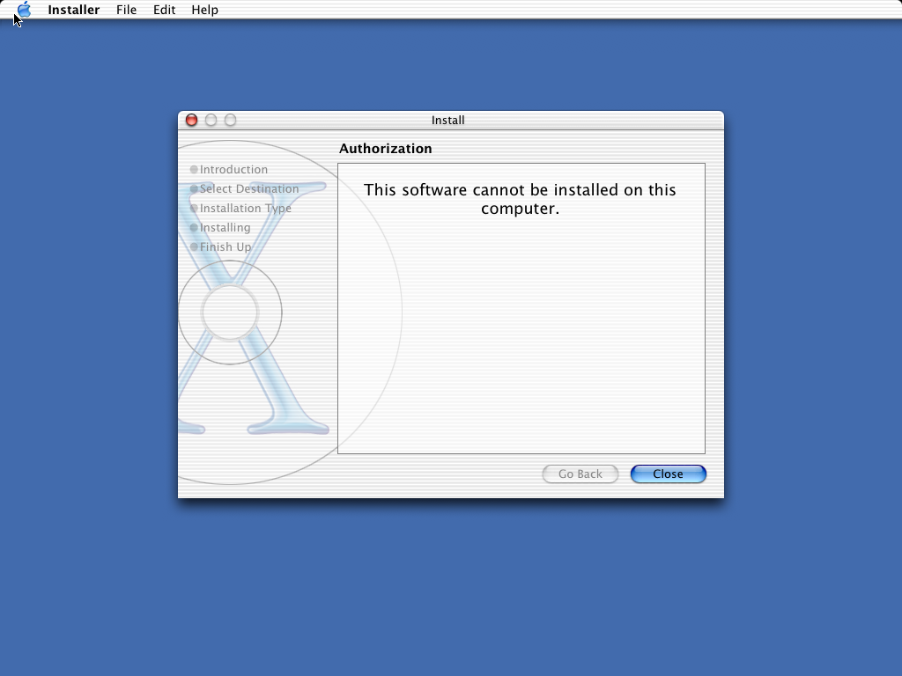

# Continuación desde direct66

Trabajo del 26 de octubre de 2026 (Buenos Aires). **Objetivo alcanzado en el ensayo102: primera ventana auténtica del Installer original de Jaguar sobre el framebuffer VESA de Darwin 6 i386.** La ventana «Install» muestra «Authorization», «This software cannot be installed on this computer», «Go Back» y «Close». No se han simulado píxeles, respuestas CGS ni servicios, ni modificado el kernel original. Se verifica la primera ventana; no se afirma que la instalación completa funcione. Las secciones siguientes conservan la secuencia de investigación; al final están la evidencia y la recuperación del resultado102.



## Diagnóstico de direct66

Los cuatro hashes del checkpoint original coinciden: `reports/graphics-011/resume-validation/direct66-preserved-hash-recheck.json`. La máquina original permanece detenida en el monitor 4444.

Se recuperaron seis logs completos, sin páginas ausentes, desde los objetos UBC de la RAM detenida. El disco por sí solo contenía archivos de log vacíos. Evidencia y procedencia física: `reports/graphics-011/direct66/verified-recovery/`. Herramienta reproducible: `tools/recover_graphics011_direct66.py`, sobre `build/direct66-inspection/ram.bin`.

Installer era PID 3860: su código PPC original llamó `exit(1)`; `leaders.status` contiene `raw=256`. La pila y los puntos de observación posteriores lo localizan en la salida de error de `NSApplicationMain`. El mensaje original es `Unable to load nib file: PagedInstaller.nib, exiting`.

El proceso que quedó saliendo por `proc_exit/fdfree/UFS` era **ATSServer, PID 3846**, terminado después con SIGKILL durante la limpieza del arnés. `p_xstat=9`; el objeto del vnode `0x20d9c5c8` contiene la firma `0x524d0043` y PID 3846 del mailbox interno. El inode 12953 tenía 7180 bytes y nlink=0. La traza de ATS documenta el fork y exec de ese PID. No era Installer esperando en UFS. No se atribuye a UFS el fallo inicial de la aplicación.

## Correcciones y controles

- **0022:** descriptor de metadatos con FD_CLOEXEC y backing/mapa completo de 8192 bytes. No se añadió msync ni se cambió el protocolo de aplicación. El probe usa el código de mailbox de producción: ocho fork/exec y ocho SIGKILL, comprobación real de EBADF tras exec y de tamaño/nlink. Pasa en run67; el código anterior falla en el control run68. Joint67 completa limpieza y exportación (`script_exit=0`), aunque Installer todavía sale con 1.
- **0023–0024:** diagnóstico acotado de pila PPC al salir, breakpoints de observación en AppKit y trazas de rutas. Son observaciones del código original; no cambian sus resultados.
- **Recursos75:** el gnutar original trunca a 99 bytes un campo name de USTAR ocupado por exactamente 100 bytes. `classes.nib` y `objects.nib` del nib principal estaban como `classes.ni` y `objects.ni`. Se restauraron 46 rutas afectadas sin borrar sus alias truncados. Los bytes se verificaron directamente contra el CD. El ensayo nativo tar76 reproduce el defecto y verifica el uso del campo prefix: ambos archivos conservan sus nombres esperados en el caso corregido. Restaurar esos nombres no bastó por sí solo para cargar el nib.
- **Rutas78:** el arnés histórico entregaba a argv[0] una ruta del host `/var/tmp/jaguar/...`. La resolución componente a componente dentro del espacio guest intentaba consultar `/var/tmp/jaguar/var`, inexistente. El arnés nuevo usa la opción existente `--exec-argv0` con `/Applications/...` o `/System/...`. El binario que se abre sigue siendo exactamente el original. Se conservó el arnés histórico por separado.
- **0025:** ATS alcanzó el límite fijo de 128 nombres Mach explícitos y el traductor salió; Installer permaneció vivo reintentando el puerto del servidor caído (`MACH_SEND_INVALID_DEST`). La tabla ahora crece bajo demanda y se reinicia correctamente en el hijo de fork. Los nombres y derechos siguen siendo los del kernel real. La referencia i386 y PPC pasa 256 derechos concurrentes, renombrado entre nombres altos, colisión, entrega de mensajes y destroy/reutilización en dos ciclos. El ejecutor anterior termina con 125 en el control negativo.
- **0026:** prefijo estable para errores fatales y opción para omitir solamente el ruido de traps TLS. Se mantienen las trazas Mach y BSD. El arnés nuevo detecta el prefijo y corta ante un fallo del backend.

Los parches 0022–0026 y sus manifiestos reproducen los 18 fuentes en copias aisladas. Las pruebas de aplicación están en `resume-validation/*-patch-reproduction.txt`.

## Validaciones completadas

- Run67: mailbox nativo y 17 probes PPC acumulados, exit=0/timeout=0.
- Reg70: 18 estados, 23 utilidades y 11 filesystem; todos pasan, leftover=0. Es anterior a 0025.
- Linux73: compilación limpia, 11/11 fixtures. El intento incremental Linux71 conservado no es una validación: reutilizó objetos incompatibles del build copiado; la compilación limpia resolvió esos fallos.
- Bundle74: referencias i386 y PPC encuentran Info.plist, NSMainNibFile y las tres variantes de búsqueda del nib por CoreFoundation, exit=0/timeout=0.
- Tar76: defecto de nombres de 100 bytes reproducido con gnutar nativo; prefijo corregido verificado.
- Run81: 256 nombres concurrentes nativo/PPC y 17 probes PPC acumulados pasan; negativo contra el ejecutor anterior falla como se esperaba. El arranque conjunto fue detenido para recuperación: no se declara PASS ni exportación final de joint81.

Kernel original: MD5 `56da829d60b6b4353c25cca8b060b5f8`. Installer original: MD5 `1496d181829e74bd60de5fd3f9222185`. Los recursos restaurados tienen manifiestos SHA-256 propios y comprobaciones MD5 dentro del guest.

## Checkpoints y continuación activa

Se conservaron RAM/migración, disco y VRAM antes de abandonar los ensayos 78 y 81. Los manifiestos con hashes están en `resume-validation/trial78-machine-checkpoint.json` y `trial81-machine-checkpoint.json`. Son adicionales al checkpoint direct66; no lo sobrescriben.

Monitores: 4444=direct66 detenido; 4445=trial78 detenido; 4446=trial81 detenido; 4447=overlay fonts82 de recuperación en frío. Cada VM tiene 512 MB. Las reparaciones fsck se ejecutaron únicamente en overlays nuevos. Los logs pendientes en RAM permanecen en las migraciones preservadas.

La traza confirmó que `/System/Library/Fonts` no existía en el árbol Jaguar incompleto. Fonts82 restauró doce fuentes originales del mismo CD (10.2 MB, sin caches prefabricadas), verificó sus doce MD5 dentro del guest y completó limpieza/exportación (`script_exit=0`). Manifiesto: `resume-validation/fonts82-original-cd-manifest.json`. ATS avanzó hasta su prueba real de escritura de caché y encontró `utimes`, syscall 138, todavía sin traducir. No apareció una ventana verificada.

**0027:** convierte los dos timeval PPC32 y llama al `utimes` nativo. La referencia i386 y PPC de utimes84 coincide: segundos, precisión realmente almacenada, NULL para hora actual, ENOENT y EFAULT. El ejecutor anterior sale con 125 ante la llamada. La primera versión del probe, utimes83, exigía nanosegundos que tampoco conserva el UFS nativo; ese fallo de expectativa se conserva por separado. La referencia demuestra que ambos tiempos se almacenan con nanosegundos cero en este volumen. Joint84 completó limpieza y exportación; ATS alcanzó la llamada privada Carbon `delete` 226. Installer fue terminado por el arnés al detectar el error del backend.

**0028:** delega `delete` al syscall 226 del kernel original y conserva NODELETEBUSY. Delete85 i386 verifica EBUSY con archivo abierto, borrado cerrado, ENOENT, EFAULT y EPERM para directorios. El probe PPC reveló que faltaba traducir EBUSY: se añadió el valor Darwin 16. La compilación delete86 terminó, pero la copia del ejecutor agotó el disco de 2 GB; no se ejecutó su arranque gráfico. Los parches 0027–0028 reproducen los 18 fuentes en copias aisladas. El control completo de delete aún debe repetirse.

Se preservó también trial86 con RAM, disco, FAT y VRAM (`resume-validation/trial86-machine-checkpoint.json`). 4447 queda detenido. El primer clon con disco adicional (4448/storage87) encontró errores de escritura de la caché de perfiles nativa al arrancar con la raíz llena y una ejecución nativa que no terminó. Se detuvo; los registros de lectura de RAM sitúan las muestras en `bsd_read_page_cache_file`/`ffs_read`. No se atribuye ese fallo al traductor.

Storage88 (4449) parte del checkpoint trial81, anterior al disco lleno. Se creó un volumen UFS nuevo de 4 GB con el `newfs` original, después de verificar IOMedia: `/dev/disk1s1`; FAT pasó a `/dev/disk2`. `cp -Rp` conservó los datos pero intentó cambiar metadatos siguiendo enlaces absolutos de Jaguar. Un comparador nativo verificó bytes, tipos, permisos y destinos de enlaces contra el árbol original y restauró solamente los permisos cambiados en la copia. La pasada estricta posterior pasó: 16.808 archivos, 464 symlinks, 2.094 directorios, 1.115.241.082 bytes y cero correcciones en esa pasada. Los logs completos están en `reports/graphics-011/storage88/storage88-complete/`. El volumen se montó sobre `/var/tmp`; el árbol subyacente de la raíz sigue intacto. Quedan 2,6 GiB disponibles. Kernel e Installer mantienen sus MD5. El checkpoint storage88 incluye también el volumen de trabajo independiente.

Linux89: compilación limpia del código hasta 0028 y 11/11 fixtures PASS. No reemplaza la validación funcional de Darwin.

## Avance con el volumen ampliado

- Run89: 21 probes positivos y dos controles negativos pasan, incluidos `utimes` y `delete`. Joint89 corta al detectar el rechazo de `open` con flags `0x26` en ATS (`fontTablesAnnex`).
- Reg90: regresión completa sobre 0028; 18 estados exit=0/timeout=0, 23/23 utilidades y 11/11 filesystem, leftover=0; script_exit=0.
- **0029:** `O_SHLOCK`/`O_EXLOCK` nativos. `open` libera el gate durante la llamada al kernel para permitir el cierre desde otro hilo. Probe91 i386 pasa contención exclusiva, coexistencia compartida y un bloqueo liberado por otro pthread; PPC supera esa operación y descubre la llamada 331 al salir del pthread original.
- **0030:** `__disable_threadsignal` real sobre el hilo nativo actual. Probe92 i386/PPC pasa todo el ciclo, incluida creación, salida y join del pthread original; el ejecutor91 falla en el control negativo. ATS avanza hasta fsync95.
- **0031:** `fsync` real del descriptor mapeado. Probe93 i386/PPC verifica datos, offset, descriptor de lectura, EBADF y EINVAL para pipe; el ejecutor92 falla como se esperaba. ATS abre/mapea las doce fuentes originales y solicita F_NOCACHE.
- **0032:** `fcntl(F_NOCACHE)` real, con errores del kernel. Probe94 i386/PPC pasa activación/desactivación, I/O, EBADF para descriptor cerrado y pipe; el anterior falla como se esperaba. Joint94 mantiene vivos los cuatro servicios/aplicación y llega de nuevo a AppKit. Installer crea `com.apple.IntlDataCache` y encuentra fchmod124 sin traducir. No es un bloqueo por falta de memoria: una muestra conserva 76.788 páginas libres. El arnés termina y exporta el ensayo al detectar el error.
- **0033:** `fchmod` nativo sobre el descriptor real; probe95 i386/PPC pasa modos 0660/0400, contenido inalterado y EBADF. Joint95 abre el archivo de caché parcial creado antes por el propio Installer y solicita F_SETLKW.
- **0034–0035:** locks POSIX nativos con flock PPC32 de 24 bytes y offsets de 64 bits. Probe96 verifica rango superior a 4 GB, PID dueño, contención y entrega bloqueante entre padre/hijo; descubre una omisión de EBADF para descriptor virtual cerrado, corregida en 0035. Probe97 i386/PPC completo pasa; negativo contra96 falla con exit=1 en ese error. El archivo real IntlDataCache se construye y se mapea; no se borró ni fabricó.
- Joint97: Installer recibe respuestas reales de FontObjectsServer, incluidas regiones OOL, las consume y las libera. Después reitera thread_switch con pista no nula. El traductor todavía devolvía KERN_INVALID_ARGUMENT para toda pista no nula. El ensayo alcanza su límite y completa limpieza/exportación; no aparece una ventana. Checkpoint adicional con puertos, locks, UBC, discos y VRAM vivos: `resume-validation/trial97-machine-checkpoint.json`.
- **0036:** pasa la capacidad nativa real como pista a thread_switch. Probe99 confirma self, hilo auxiliar, nombre inexistente y puerto que no es hilo, espera real y opciones inválidas; los resultados trazados son los del kernel. Descubre swtch_pri al completar el pthread_join. Probe98 conserva un error de firma en el primer código de prueba, corregido antes de99; no se cuenta como PASS.
- **0037:** swtch_pri del scheduler nativo con su booleano real. Probe100 i386/PPC completa todo el ciclo; negativo contra98 falla en -59 como se esperaba. Joint100 cargó PagedInstaller, PageUI y Splash, pero ATS agotó la tabla fija de 4096 exportaciones Mach nativas. El arnés nuevo lee las trazas incrementalmente, detecta errores aun si el líder ya salió y permite un presupuesto explícito de hasta 120 muestras. Joint100 usa 72×5 segundos guest con captura/diagnóstico externo.

El FAT16 agotó entradas de su directorio raíz. Se preservó una copia completa con SHA y se reubicó solamente el archivo propio de transferencia98, verificando sus bytes; las transferencias nuevas y resultados usan `/RUNS`. Evidencia: `resume-validation/exchange100-relocation.json`. Los checkpoints previos no se tocaron. El primer payload100 no llegó a transferirse; el paquete100a es el que efectivamente se ejecuta. Linux95 es una compilación limpia hasta0033, con 11/11 fixtures PASS.

Los parches numerados se reproducen individualmente sobre su predecesor. `tools/reproduce_graphics011_patch_chain.py` permite aplicar la cadena completa en una copia nueva de un checkpoint fuente, sin modificar la base; `chain21-through38-reproduction.txt` verifica los 18 fuentes hasta0038. Los binarios Apple siguen sin cambios. Hasta el ensayo100 no se había verificado una ventana; el resultado102 se documenta a continuación.

Los capturadores conservan screendump, bytes físicos de VRAM y hashes. Una detección automática es solamente un candidato: requiere inspección visual y correspondencia con trazas del Installer original antes de declarar una ventana auténtica.

## Primera ventana auténtica: ensayo102

**0038:** después de las 4096 entradas rápidas, las exportaciones Mach automáticas usan nombres virtuales monotónicos en la tabla dinámica existente. Cada entrada conserva la capacidad real del kernel. También se conserva la metadata tipada de timers, notificaciones y processor sets. Las operaciones de derechos, renombrado, entrega de mensajes y espera siguen delegadas al kernel original. No se añadió ningún servicio ni respuesta CGS ficticia.

El probe102 i386/PPC pasa 4100 ciclos de creación/destrucción, invalidez de nombres retirados, renombrado y colisiones, referencias send, límites, port sets, entrega real y vencimiento de timer. Sus stdout coinciden y ambos terminan exit0/timeout0. El ejecutor100 anterior termina con125 en el límite antiguo. Pasa además la regresión de 256 nombres explícitos concurrentes. La sesión nativa con `set -e` completó todas esas comprobaciones antes de iniciar el arranque conjunto: `capacity102/probes1/2484-fd1.txt`. El ensayo101 anterior conservado tenía una expectativa errónea del test para renombrar un puerto a sí mismo: el kernel nativo también responde KERN_NAME_EXISTS. Se corrigió solamente esa expectativa en102; no se alteró el resultado del kernel.

El arranque conjunto102 usa `/var/tmp/graphics011-build101/qemu-ppc`, fuente hasta0038, 512 MB, ATS2523, WindowServer2528, pbs2533 e Installer2535. Se detuvo al aparecer el primer marco y se guardó `window102-first`; después se permitió el repintado durante un intervalo acotado y se guardó `window102-painted` con título, fondo, texto y botones completos. Los cuatro procesos seguían vivos. No se ejecutaron fixtures que escriben patrones en el framebuffer durante este arranque.

La ventana es la pantalla de rechazo original de la aplicación. **No se ha establecido todavía por qué rechaza esta computadora**, ni se afirma que sea una limitación del traductor, de la arquitectura o del hardware emulado. No fue necesario resolver ese rechazo para alcanzar el objetivo de la primera ventana. La VM queda pausada antes de la limpieza del arnés; joint102 no se declara completado ni exportado por el guest.

### Evidencia comprobada

- [Captura íntegra, sin modificación de píxeles](../reports/graphics-011/capacity102/verified/verified-window.png).
- [Verificación del framebuffer](../reports/graphics-011/capacity102/verified/framebuffer-verification.json): 3.145.728 bytes físicos desde `0xfd000000`, 1024×768×32 BGRX. Cero diferencias en los 786.432 píxeles contra el screendump, incluidos los píxeles de la ventana. SHA-256 VRAM `a19cc563a7849cd1f139fef927b2ddda8855d4daae2515ff077cbf80fcc7aa22`; RGB `b7e34c19cd42aec838237b12dde424a10580fc26b74c2b16c11cf6e542380bfe`.
- [Índice de autenticidad, hashes y correlación de trazas](../reports/graphics-011/capacity102/verified/authenticity.json). El Installer2535 abre sus `PagedInstaller.nib/objects.nib`, `PageUI.nib/objects.nib`, `Splash.nib/objects.nib` y `background.tif`. Emite solicitudes CGS29206/29210; WindowServer2528 recibe esas solicitudes y produce las respuestas29306/29310. Los IDs se contrastan con el desensamblado de los stubs originales `__CGSCreateWindow` y `__CGSOrderWindow`, conservado junto al índice.
- [Trazas del Installer](../reports/graphics-011/capacity102/window-evidence/2535-fd2.txt) y [WindowServer](../reports/graphics-011/capacity102/window-evidence/2528-fd2.txt), recuperadas sin agujeros desde sus vnodes abiertos/UBC con la VM detenida. `window-evidence/processes.json` registra la procedencia. Los logs completos y toda la memoria permanecen en la migración; el extracto final de ATS está limitado a los últimos4 MiB.
- MD5 originales conservados: kernel `56da829d60b6b4353c25cca8b060b5f8`, Installer `1496d181829e74bd60de5fd3f9222185`. Las doce fuentes y los recursos restaurados proceden del mismo CD y tienen sus verificaciones separadas. No se reemplazaron binarios Apple.
- [Restauración independiente](../reports/graphics-011/capacity102/restored-verification/framebuffer-verification.json): otra VM, discos nuevos sobre los preservados y RAM restaurada, reproduce exactamente los hashes del PPM, VRAM y RGB. También tiene cero diferencias entre VRAM y captura. No se reanudó esa copia para esta comprobación.
- [Reverificación final de direct66](../reports/graphics-011/resume-validation/direct66-after-window102-hash-recheck.json): sus cuatro archivos preservados mantienen sus hashes originales.

### Estado conservado y reproducción

Monitor4444 conserva direct66; 4449 tiene la ventana102 detenida; 4450 es la restauración de verificación detenida. Los checkpoints anteriores siguen intactos. Los manifiestos completos son [window102-first](../reports/graphics-011/resume-validation/window102-first-machine-checkpoint.json) y [window102-painted](../reports/graphics-011/resume-validation/window102-painted-machine-checkpoint.json); incluyen migración, raíz, FAT, volumen UFS de trabajo, VRAM y PPM con hashes. La raíz qcow2 preservada mantiene su cadena de backing anterior, que también debe conservarse.

Para restaurar otra copia **sin escribir los checkpoints**, desde la raíz del repositorio en WSL, usar un nombre y puerto libres:

```sh
python3 tools/restore_graphics011_checkpoint.py --from-label window102-painted --as-label nueva-copia --port 4451
```

La herramienta verifica los seis hashes del manifiesto, crea overlays nuevos para raíz/trabajo, copia el FAT y carga la migración con `-S`. Queda detenida. No ejecutar el arranque en frío sobre los discos preservados: la migración contiene también las páginas UBC pendientes y los puertos/locks vivos. Para continuar la VM actual, el comando es `python3 tools/qemu_monitor.py --port 4449 cont`; se reanuda también el presupuesto pendiente del arnés. No introducir comandos de teclado mientras WindowServer esté activo.

Para verificar otra captura detenida:

```sh
python3 tools/verify_graphics011_window.py --vram build/011-window102-painted-preserved-vram.bin --ppm build/011-window102-painted-preserved.ppm --out reports/graphics-011/otra-verificacion
```

Para reproducir la cadena fuente en un destino inexistente:

```sh
python3 tools/reproduce_graphics011_patch_chain.py --base build/011-vmcopy-patch-check --dest build/011-reproduccion-nueva --after 21 --through 38
```

Las validaciones Linux95 y Reg90 corresponden a los niveles fuente indicados antes; no se presentan como suites completas de0038. Para0038 se completaron los probes nativos/PPC102, el control negativo, la regresión de nombres explícitos, la reproducción de los18 fuentes y este arranque gráfico verificado. Los textos `pending` de algunos manifiestos reflejan el momento de exportación; las validaciones posteriores están registradas aquí y en los resultados de cada ensayo.

La continuación de entrada, los bloqueos siguientes y el cierre autorizado para publicación están en [el informe de entrada e Installer](remaklar-0.11-entrada-installer.md).
