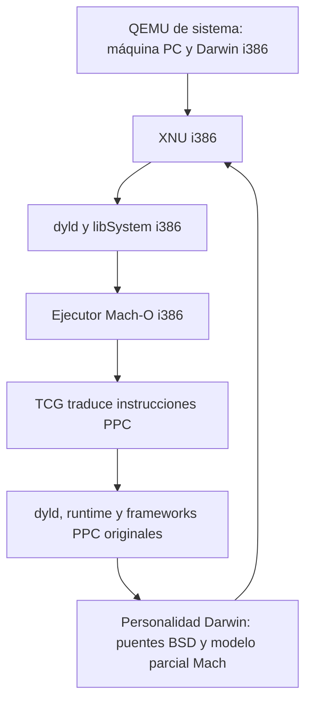

# ReMaklar 0.06: auditoría y propuesta de arquitectura para 0.07

Fecha: 25 de octubre de 2026. Alcance: investigación, comprobación de evidencia y planificación; **no se implementaron funcionalidades ni se modificaron ejecutables, fuentes, parches o imágenes de disco**. La implementación queda pendiente de revisión y aprobación del plan.

## 1. Dictamen

Recomiendo **C: estrategia híbrida con desarrollo prioritario nativo i386**. Conservar el ejecutor PPC como instrumento de comparación y compatibilidad acotada; construir y verificar cada nuevo servicio del sistema en Darwin 6 i386. No hacer del arranque de WindowServer PPC la puerta obligatoria para avanzar.

Hay evidencia local sustancial de ejecución de código original: Objective-C, operaciones básicas de CoreFoundation y Foundation, y un bitmap generado por CoreGraphics. **Es código PPC traducido**, incluso cuando el ejecutor es Mach-O i386 y corre dentro de Darwin. No acredita Cocoa/Quartz i386 ni un escritorio Aqua.

Darwin ya aporta kernel, dyld, libSystem y bibliotecas con slices i386. La copia del CD Darwin contiene también **CoreFoundation 262 y libobjc 218 con slice i386**. El siguiente experimento debería ejercitar directamente esa cadena nativa, sin pasar por QEMU PPC, antes de reconstruir bibliotecas que ya existen. Sus capacidades completas y la compatibilidad con CoreFoundation 263 de Jaguar retail siguen sin demostrarse.

La distribución abierta 10.2.8 aporta XNU **344.49**, objc4 **222**, cctools **435.4** —incluido dyld— y numerosas piezas Darwin. **No aporta el conjunto completo de Jaguar**: no hay proyectos CoreFoundation/CF, Foundation, AppKit, CoreGraphics o WindowServer en ese manifiesto. IOGraphics es infraestructura de dispositivos, framebuffer y cursor; no es una implementación de Quartz.

WindowServer llega a la entrada original `0x2998` y la última ejecución registrada termina con estado 125 en **`fork`, syscall 2**, no en un timeout ni en `vfork`. Esa es una causa inmediata comprobable en los registros; no demuestra que corregirla permita iniciar el servidor. Faltan comunicación Mach entre procesos, servicios bootstrap, threads, memoria compartida y acceso gráfico verificable.

## 2. Método y niveles de evidencia

- **V — verificado en esta auditoría:** lectura de archivos/binarios, cálculo de hashes, inspección de fuentes primarias o prueba efectivamente ejecutada ahora.
- **R — registro histórico corroborado:** log anterior revisado junto con caller, formato binario, estado de salida y/o artefacto. No equivale a una nueva ejecución.
- **H — hipótesis o decisión propuesta:** interpretación o diseño que necesita un experimento.
- **P — pendiente:** no hay evidencia suficiente para declararlo funcional.

Se inspeccionaron documentación e historial, scripts de construcción y pruebas, cambios locales, inventarios, logs 0.03–0.06, código de la personalidad Darwin/QEMU y fuentes Darwin locales. Se consultó por GitHub la [distribución oficial 10.2.8](https://github.com/apple-oss-distributions/distribution-macOS/tree/mac-os-x-1028), sus gitlinks, commits de importación y archivos seleccionados. No hubo clone recursivo, descarga indiscriminada, compilación de Apple ni incorporación de Tiger. La auditoría no es una revisión línea por línea de todo XNU o QEMU.

## 3. Estado real del repositorio

### 3.1 Árbol principal y repositorios auxiliares

**V:** rama `main`, HEAD `26747ac65cf4fce144e2b24e730448b6b7afe6b1` (`Prepare Jaguar runtime contract tests and original Quartz bitmap caller`). Antecedentes relevantes: `6b67d71` cierra 0.05, `cb34b1c` documenta 0.04, `f589887` documenta el ejecutor sobre Darwin. README sigue encabezado por 0.05; no es un resumen actualizado de los experimentos 0.06.

Estado inicial, preservado:

```text
 M scripts/build-jaguar-probes.pl
 M scripts/darwin6-runtime.sh
 M tests/ppc/cf-smoke.c
 M tests/ppc/mach-runtime.c
?? research/graphics-006/
?? scripts/darwin6-cold-runtime.sh
?? scripts/darwin6-runtime-evidence.sh
?? tests/ppc/graphics-contracts.c
?? tests/ppc/run_runtime.py
?? tools/export_runtime_checkpoint.py
?? tools/inspect_jaguar_drivers.py
?? tools/prepare_jaguar_media.py
```

El diff registrado contiene 26 inserciones y 3 eliminaciones: cambio de enlace Quartz a ApplicationServices, declaraciones públicas mínimas de CF ante headers ausentes, pruebas de notificaciones Mach y contratos gráficos. Los archivos no rastreados constituyen trabajo real existente, no tareas por generar nuevamente.

El repositorio independiente ignorado `experiments/qemu-0.10.6` está limpio, en `remaklar/0.06-runtime`, HEAD **`2e4ce5b0d163c2a6882e43c20869f4363916cd48`**. Sus avances respecto de 0.05 incluyen `c33a4a4` (ptrace/reloj/puertos), `66bfca1` (mapeos de bibliotecas Jaguar), `21adb78` (fronteras ColorSync) y `2e4ce5b` (longitud de hostname). Esos commits **no están incorporados como parche 0005 en el repositorio principal**.

Los checkouts bajo `sources/` tampoco deben describirse indiscriminadamente como limpios. XNU muestra 2386 archivos modificados; Libc 1319, cctools 606, Csu 9, shell_cmds 399 y el manifiesto 2. En todos ellos `git diff --ignore-space-at-eol --quiet` devuelve 0: las diferencias observadas desaparecen al ignorar espacios/finales de línea. objc4, file_cmds y text_cmds están limpios. Esto no prueba reconstrucción binaria ni autoriza normalizar esos árboles. No se los modificó.

### 3.2 Brecha de reproducibilidad de 0.06

**V:** faltan estos artefactos esperados por `tools/export_runtime_checkpoint.py`:

- `patches/qemu-0.10.6/0005-runtime-quartz.patch`;
- `reports/remaklar-0.06.json` y `reports/runtime-006/`;
- `logs/runtime-cold-006/`;
- `vm/darwin602-runtime-006-verified.qcow2`.

`scripts/checkout-qemu.sh` aplica hasta 0004 y su valor por defecto sigue siendo `0.05-filesystem`. Un checkout limpio **no reproduce el ejecutor 0.06** mediante esa receta. El exportador contiene afirmaciones sobre cold boot y snapshot futuro, pero el texto de un script no es evidencia de su ejecución. No se ejecutó: escribe parches/informes y depende de entradas ausentes. Las capturas `runtime-006-coldboot.png` y `runtime-006-halt.png` no sustituyen los resultados exportados que faltan.

**V:** los SHA-256 de los snapshots 0.03, 0.04 y 0.05 coinciden con sus informes anteriores. Se verificó identidad de archivos, no se arrancaron ni se ejecutó una reparación del filesystem:

| Snapshot | SHA-256 |
|---|---|
| `darwin602-native-003-verified.qcow2` | `24b64365b67a7fd1d038e5d0b51d3bd82c1d70bda8a5a58cee416cd8186b4ee7` |
| `darwin602-utilities-004-verified.qcow2` | `d1743b76c634c3a4393eed55fea8f9f1aade4144419fb3587afee2428209fb35` |
| `darwin602-filesystem-005-verified.qcow2` | `a624142c4b2f4989c5529f5ab5479cb748ae637790efaf478647145ba3c80d16` |

### 3.3 Cohortes que no deben mezclarse

| Cohorte | Identidad y alcance |
|---|---|
| Instalación Darwin x86 | **R:** `logs/runtime-native-005/host.txt`: Darwin 6.0, kernel del 21/10/2002, `RELEASE_I386`, raíz UFS. El CD se denomina Darwin 6.0.2; la documentación registra otro kernel en el arranque del CD, Darwin 6.1/344.2.3. |
| Fuentes locales iniciales | **V:** XNU `344` (`fad439e`), cctools `435` (`1b2a137`), Libc `262` (`e6868d7`), objc4 `222` (`f44f3c3`), Csu `45` (`f35b586`). No son automáticamente los fuentes exactos de cada binario instalado. |
| Jaguar extraído | **V:** `research/jaguar-local/Mac OS X Install Disc 1/System/Library/CoreServices/SystemVersion.plist`: **10.2, build 6C115**, no 10.2.8. |
| Referencia de investigación | **V:** manifiesto Apple `mac-os-x-1028`, XNU 344.49 y versiones del inventario siguiente. No se instaló esa actualización. |

Un hash coincidente acredita conservación respecto del inventario local, no autenticidad de origen por sí solo. Se recalcularon y coinciden los once originales de `reports/remaklar-0.05.json` y los siete de `research/graphics-006/catalog.json`.

## 4. Qué funciona y bajo qué arquitectura

### 4.1 Inventario binario comprobado

Se volvieron a leer las cabeceras FAT/Mach-O y sus load commands con `tools/macho_inventory.py`; CPU 7 = i386, CPU 18 = PPC. Versiones de la tabla = `LC_ID_DYLIB current_version`, **no necesariamente versión del paquete fuente**.

| Componente | CD Darwin local | Jaguar 6C115 local | Estado funcional y límite |
|---|---|---|---|
| XNU y entorno de consola | Kernel i386 instalado | No se usa su kernel PPC | **R:** arranque monousuario y compilación i386. No escritorio ni arranque multiusuario saneado. |
| Ejecutor ReMaklar | `run06`: Mach-O CPU 7; host Linux: ELF i386 | Selecciona PPC | Traducción TCG de aplicaciones PPC. No conversión a aplicaciones nativas. |
| dyld | FAT PPC+i386 | PPC | **R:** dyld PPC original carga las dependencias de pruebas. Dyld i386 sirve al ejecutor nativo; no existe un dyld mixto PPC/i386. |
| libSystem | FAT PPC+i386, 60.0.0 | PPC, 60.0.0 | **R:** bibliotecas originales en ambas funciones. Cobertura de llamadas limitada; no todos los servicios del sistema. |
| libobjc | FAT PPC+i386, 218.0.0 | PPC, 218.0.0 | **R:** clase propia, método que retorna 42, creación/liberación mediante runtime PPC. **P:** repetir caller i386 directamente. |
| CoreFoundation | FAT PPC+i386, 262.0.0 | PPC, 263.0.0 | **R:** strings UTF-8, array, retención/liberación y reloj en caller PPC. **P:** CF i386, runloop, callbacks y servicios más amplios. |
| Foundation | No está en la raíz de muestras Darwin inspeccionada | PPC, 462.0.0 | **R:** NSArray, NSString y NSAutoreleasePool. No NSApplication, concurrencia general ni Foundation i386. Ausencia en esa raíz no prueba ausencia en todo el CD. |
| CoreGraphics/Quartz | Sin proveedor i386 verificado | PPC, 157.0.0 | **R:** CGBitmapContext y relleno de rectángulos en memoria. No presentación en pantalla, texto, PDF completo o compositor. |
| Window Manager | Sin proveedor i386 verificado | PPC, entrada `0x2998` | **R:** entra y aborta en syscall 2. El caller importa `_CGXServer`; gran parte del servidor reside en CoreGraphics. |
| AppKit | Sin proveedor i386 verificado | PPC, 663.0.0 | **V:** inventario de archivo/dependencias. **P:** ejecución de aplicación AppKit. |
| IOKit/IOGraphics/driver | Infraestructura Darwin nativa; acceso gráfico no probado | Inventario de IOGraphicsFamily y ATIRage128 PPC | No se cargaron esos kexts en i386. Traducir procesos de usuario no traduce drivers del kernel. |

**R:** los logs `runtime-native-005` registran 12 casos PPC con salida 0: cinco callers en cada una de las raíces Darwin y Jaguar, más Foundation y Quartz Jaguar. `runtime-linux-006/results.json` registra esos mismos 12. Los callers recuperados en `build/runtime-006-owned/` son Mach-O PPC; el ejecutor `run06` es i386. Siete MD5 —ejecutor y seis callers, excluyendo ptrace-host, que no figura en ese listado— coinciden con `logs/runtime-native-005/owned.md5`.

Los controles `mach-native`, `graphics-native` y `ptrace-oracle` sí se ejecutaban directamente como programas nativos según script y logs. Su alcance: contratos concretos de puertos/reloj, errores de sockets/shared memory y denegación ptrace. **`graphics-native` no renderiza gráficos**: comprueba sockets, flags, interfaces, hostname y ENOENT de un objeto shm inexistente.

### 4.2 Traducción, emulación y pruebas sintéticas

La ruta histórica sobre Darwin es:



La VM de sistema emula hardware y, en el laboratorio TCG documentado, la CPU x86. Dentro de ella, un ejecutable i386 es nativo **respecto del ISA y ABI de Darwin huésped**; eso no acredita ejecución sobre hardware físico ni elimina la segunda traducción de las aplicaciones PPC. En Linux el ejecutor es ELF y usa una personalidad Darwin, no XNU como kernel host.

`darwin-user/remaklar/darwin-kernel.c` distingue operaciones reales del host y un modelo local:

- BSD read/write/stat/directorios/socket se traducen mediante estructuras y descriptores explícitos; las pruebas usan código PPC real.
- Puertos `TASK_SELF=0x101`, `THREAD_SELF=0x102`, etc. y arrays de derechos representan un **namespace emulado dentro del proceso**, incluso en el build Darwin. No equivalen a puertos XNU utilizables por otros procesos.
- `rpc()` solo acepta el patrón sincrónico send+receive. Registro de dead-name notifications no incluye entrega del evento ni ciclo completo de destrucción.
- `bootstrap_look_up` devuelve `BOOTSTRAP_UNKNOWN_SERVICE` (1102) en un namespace vacío. No hay servidor simulado que esté funcionando.
- `shm_open` sin creación devuelve ENOENT; la creación aborta como no implementada. No hay memoria de superficies compartida entre procesos.
- `private_shared_file()` preserva geometría de segmentos en mapeos **privados**. Esto permite cargar bibliotecas split-segment, pero no implementa el shared region global de Jaguar.
- Reloj monotónico convertido a nanosegundos y timebase 1/1; thread-self único. No scheduler de threads PPC ni semántica completa de pthreads/señales.

Los once fixtures son programas sintéticos que ejercitan el traductor. Los smoke tests ejecutan instrucciones originales de bibliotecas, pero un resultado pequeño correcto no verifica todas sus APIs. Las pruebas main-only históricas omiten startup explícitamente; no se las cuenta como ejecución completa.

### 4.3 Verificaciones ejecutadas durante esta auditoría

Host actual: Linux x86_64, usuario 1000, `vm.mmap_min_addr=65536`. El ejecutor almacenado no tiene bit ejecutable (modo 0664). El intento directo produjo `PermissionError`; se copió byte a byte a `/tmp`, se dio permiso de ejecución **solo a esa copia** y se verificó su SHA-256. No se recompiló ni se alteraron permisos en el proyecto.

| Verificación actual | Resultado | Interpretación |
|---|---|---|
| `tests/ppc/run_tests.py` con ejecutor 0.06 y salida temporal | **11/11 PASS**, estado del runner 0 | Se ejecutaron fixtures PPC: salida, endianess, errores, instrucciones inválidas y loader. |
| `tests/ppc/test_dynamic.py` con el mismo ejecutor | **true FAIL, false FAIL; missing-dyld PASS**, runner 1 | Ambos positivos terminan 125 con `load_segment: can't mmap at 0x1000`, antes de startup. No es un éxito dinámico. |
| Política/privilegios de host | Límite de mmap 64 KiB; `sudo -n true` requiere contraseña | **H fuertemente sustentada:** restricción de direcciones bajas explica el fallo. No se cambió sysctl ni se elevó privilegio. No se ensayaron allí los casos de frameworks que requieren la misma carga. |
| PPM histórico Linux y Darwin | Cada archivo coincide con **todos** los píxeles esperados y entre sí | 64×48, 2304 píxeles azules y 768 rojos. Verificación de artefactos existentes, no nuevo render. |
| Formatos, dependencias y hashes | Coincidencias descritas arriba | Inspección independiente de inventarios anteriores. |
| Snapshots 0.03–0.05 | SHA-256 coincidentes | Conservados; no prueba nueva de arranque. |

No se arrancó una VM ni se recompilaron callers en esta auditoría. Las pruebas dinámicas sobre Darwin y las 23 pruebas echo/cat + 11 filesystem siguen siendo **R**, respaldadas por `logs/runtime-native-005/{baseline,utilities,filesystem,regression-status}.txt` y los informes versionados anteriores. No se afirma repetición completa ni cold boot 0.06 exitoso.

PPM verificado: `d45bc57449c1e95c6571a4a0a5221ed1dda3f00329600be35c0223afa77ad192`.

## 5. Fuentes oficiales Jaguar 10.2.8

### 5.1 Inventario de reutilización

Los enlaces siguientes fijan commits del manifiesto consultado. «Integración» distingue binarios preexistentes de reconstrucción desde fuente; **no se reconstruyó ninguno de estos paquetes durante la auditoría**. Licencia indica textos observados, no una autorización de redistribución de todo el sistema. Los avisos por archivo y terceros se conservan por separado.

| Componente/versión oficial | Soporte i386 y función | Estado en ReMaklar / reutilización y dependencias | Licencia observada |
|---|---|---|---|
| [XNU 344.49](https://github.com/apple-oss-distributions/xnu/tree/0554d6e8acf48133ff365f11d47a23d7fea8da23) | Sí: `osfmk/i386`, `bsd/dev/i386`, `pexpert/i386`; VM, tareas, threads, IPC y BSD | Kernel i386 binario ya usado; fuente local 344, **no 344.49 integrado**. Reutilizar kernel instalado primero. Rebuild exige toolchain histórico, headers, MIG, libkern/pexpert y control de ABI. | APPLE_LICENSE APSL 2.0; archivos Mach/CMU y BSD tienen avisos adicionales. Local 344 conserva avisos anteriores: no extrapolar licencia entre tags. |
| [objc4 222](https://github.com/apple-oss-distributions/objc4/tree/f44f3c371efbca9b0eeeffe3691888b6b53fb1f0) | Sí: `runtime/Messengers.subproj/objc-msg-i386.s`; dispatch, super, variantes stret, clases y selectores | Fuente local y binario FAT; ejercicio PPC registrado. Usar slice i386 antes de reconstruir. Necesita ABI Objective-C clásico, CF, pthread y callbacks de dyld. | APPLE_LICENSE y archivos inspeccionados: APSL 1.1; avisos NeXT. |
| [Libc 262.3.2](https://github.com/apple-oss-distributions/Libc/tree/170d08dbf1fd64013db74f9d828641f8930b0e9d) | Sí: `i386/sys/SYS.h`, `i386/`, `pthreads/`; C, wrappers BSD y threads | Fuente local 262; funcionalidad distribuida en libSystem original. Reutilización nativa existente, no prueba del build 262.3.2. Dependencias Mach, syscall ABI, asm, headers y reglas de construcción. | APPLE_LICENSE APSL 2.0; código BSD y otros avisos por archivo. |
| [Libsystem 63](https://github.com/apple-oss-distributions/Libsystem/tree/0783bb1fc36018135530f7961cf81a0d42674225) | Agrega bibliotecas; `Makefile` enlaza C, dyld, info, kvm, m, macho, streams, unc y keymgr. No es una libc completa autónoma. | Binario disponible es libSystem 60 en ambas cohortes; **63 no integrado**. Usar slice i386 60 con su conjunto coherente. Rebuild necesita archivos auxiliares y pb_makefiles; `SystemMath.s` incluye contenido solo PPC. | No APPLE_LICENSE ni concesión explícita identificada en los Makefiles/SystemMath revisados. Licencias de agregados separadas; licencia del paquete pendiente, no presumir APSL uniforme. |
| [Libm 40.2](https://github.com/apple-oss-distributions/Libm/tree/97c2b0edc94ed024ece83540c86e33cc48639067) | Sí: `i386.subproj/e_sqrt.s`, math/fenv y rutas C/asm | Matemática de las bibliotecas originales en uso; no build propio. Reutilizar con entorno FP/ABI verificado, dependencias de headers y ensamblador. | APPLE_LICENSE APSL 2.0; revisar avisos de cada rutina matemática antes de copiar. |
| [Libinfo 129.4](https://github.com/apple-oss-distributions/Libinfo/tree/ba4b813d1ef78d1de8b798674a279a67ac5f1bd9) | C de resolución DNS/lookup/NetInfo, sin ensamblador i386 requerido en las rutas examinadas; build i386 exacto no probado | Indirectamente en libSystem; no integración desde fuente. Requiere servidores/protocolos de consulta, RPC y configuración. Portabilidad del C no garantiza que esos servicios existan. | `lookup.subproj/lu_utils.c`: APSL 1.1; otros subproyectos requieren revisión propia. |
| [cctools 435.4](https://github.com/apple-oss-distributions/cctools/tree/45c6aa9be8c6cd7c9ba991b8c2a371c04e12e6a3) | Sí: ensamblador/linker, otool/lipo/nm, libmacho, **dyld y libdyld**; startup y relocación i386 | Fuente local 435 y herramientas del CD; dyld nativo existente y PPC traducido. Reutilizar toolchain de época, adaptar construcción si se reconstruye; no traer dyld moderno. | APPLE_LICENSE y dyld revisado APSL 2.0; herramientas derivadas de terceros conservan sus avisos. |
| [Csu 45](https://github.com/apple-oss-distributions/Csu/tree/f35b5862caaed325d40270dcf43d5303bf11d08b) | Sí: `start.s` con rama `__i386__`, `crt.c`; entrada, inicialización y enlace a dyld | Fuente local y CRT del toolchain. Reutilizable para callers i386 con GCC histórico y libSystem correspondientes. No omitir inicializadores para lograr un smoke test. | `start.s`: APSL 1.1. |
| IOKit del [XNU fijado](https://github.com/apple-oss-distributions/xnu/blob/0554d6e8acf48133ff365f11d47a23d7fea8da23/iokit/Kernel/IOUserClient.cpp) | Núcleo C++ del sistema de drivers, user clients y puertos; forma parte de XNU con plataforma i386 | Base instalada ya tiene IOKit; no se validó acceso de un nuevo cliente gráfico. Reutilizar ABI existente; no cargar kext PPC en i386. Dependencias kernel, libkern, device tree y matching de hardware. | Archivo inspeccionado APSL 2.0; revisar resto del kernel por archivo. |
| [IOKitUser 120.3](https://github.com/apple-oss-distributions/IOKitUser/tree/aeb8cd88f4fb6709d0b715500f86c10f7172144e) | Sí, evidencia explícita: `IOSharedLock.s` incluye `IOKit/i386/IOSharedLockImp.h`. `IOKitLib.c`: matching, apertura y memoria de user clients; `iokitmig.defs` | Hay biblioteca PPC en la cadena Quartz; no se verificó una prueba gráfica i386. Reutilizar biblioteca instalada o reconstruir selectivamente con CF, MIG y headers compatibles. El código no crea un framebuffer por sí mismo. | Archivos revisados APSL 2.0. `IOTrap.s` remite al header de traps de la arquitectura. |
| [IOGraphics 45.3](https://github.com/apple-oss-distributions/IOGraphics/tree/5b856af17bcee11fe31e19ac423005d1c1665523) | `IOFramebuffer`, user clients, displays, cursor, boot framebuffer. **No se verificó build funcional i386 del conjunto**; C++ genérico reutilizable y ramas PPC específicas. | Fuentes no integradas; kexts inspeccionados son PPC. Adaptación/matching/ABI de kernel y driver real pendientes. `IOBootFramebuffer::probe` exige `AAPL,boot-display` y datos válidos de consola; no asumir que encaja en la VM actual. | Headers y fuentes de IOFramebuffer/IOBootFramebuffer revisados: APSL 2.0. |
| [bootstrap_cmds 35](https://github.com/apple-oss-distributions/bootstrap_cmds/tree/6250deca90afd8a4570d25301755d56e59a4c576) | Herramientas de build, especialmente `migcom.tproj`; no es el servidor bootstrap | Reutilización del generador para stubs i386/Mach; arquitectura final depende de headers/ABI. No hay rebuild acreditado. | `migcom.tproj/mig.c`: aviso APSL 1.0 más CMU; revisar archivos adicionales. |
| [system_cmds 230.0.2](https://github.com/apple-oss-distributions/system_cmds/tree/2178c5df981f18ea4172bfcea8dafa9ae8e0df2d) | `init.tproj`, `mach_init.tproj`, procesos y utilidades. Código mayormente común; el kernel/bibliotecas fijan arquitectura | Init/shell del Darwin instalado; servicios multiusuario incompletos. `mach_init` es candidato original para registro/búsqueda reales, no el namespace vacío del traductor. Requiere Mach, derechos, MIG, configuración y procesos. Build exacto pendiente. | APPLE_LICENSE APSL 2.0; `bootstrap.c` APSL 2.0 y avisos históricos; utilidades BSD por archivo. |
| [Startup 129](https://github.com/apple-oss-distributions/Startup/tree/c69f524564d47fe7ebe6045961ee52923a684f18) | SystemStarter, StartupItems, ruta de texto y plugin QuartzDisplay | No sustituir sesión por un script que simule éxito. `SystemStarter.c` depende de CF; QuartzDisplay usa incluso headers privados CG/CF. No demuestra disponibilidad de Quartz i386. Reutilización parcial condicionada al cierre de dependencias. | Archivos SystemStarter/QuartzDisplay revisados APSL 2.0. |

Los identificadores fijados son los gitlinks del manifiesto. Sus versiones se cotejaron con los mensajes de importación de los commits; no se supuso que todos los componentes tengan un tag llamado `mac-os-x-1028`.

Las bibliotecas auxiliares referidas por Libsystem —incluyendo Libkvm, Libstreams, libunc, keymgr y soporte de compilador— requieren completar inventario y licencias antes de reconstruir libSystem. **No se afirma que todo archivo de enlace exista por el solo hecho de estar mencionado en Makefile**. GCC, arquitectura/headers, pb_makefiles/CoreOSMakefiles, SDK y MIG forman parte de la dependencia de construcción. El GCC3 instalado fallaba por `cpp-precomp` ausente; la evidencia local favorece GCC2 2.95.2 con `-no-cpp-precomp` para el próximo ensayo.

### 5.2 Archivos y símbolos que fundamentan las conclusiones

- XNU: [traps i386](https://github.com/apple-oss-distributions/xnu/blob/0554d6e8acf48133ff365f11d47a23d7fea8da23/osfmk/i386/trap.c), [pmap](https://github.com/apple-oss-distributions/xnu/blob/0554d6e8acf48133ff365f11d47a23d7fea8da23/osfmk/i386/pmap.c), [estado BSD i386](https://github.com/apple-oss-distributions/xnu/blob/0554d6e8acf48133ff365f11d47a23d7fea8da23/osfmk/i386/bsd_i386.c), [kern_fork.c](https://github.com/apple-oss-distributions/xnu/blob/0554d6e8acf48133ff365f11d47a23d7fea8da23/bsd/kern/kern_fork.c): `fork1` y duplicación del thread. No hace falta emular estas operaciones para un proceso i386 directo.
- Objective-C: [mensajería i386](https://github.com/apple-oss-distributions/objc4/blob/f44f3c371efbca9b0eeeffe3691888b6b53fb1f0/runtime/Messengers.subproj/objc-msg-i386.s), con `objc_msgSend`, `objc_msgSendSuper` y variantes de retorno de estructuras. [_objcInit en objc-runtime.m](https://github.com/apple-oss-distributions/objc4/blob/f44f3c371efbca9b0eeeffe3691888b6b53fb1f0/runtime/objc-runtime.m) llama a `__CFInitialize`, prepara TLS y callbacks dyld. Disponer del ensamblador de dispatch no resuelve CF ni el arranque.
- dyld: [dyld_start.s](https://github.com/apple-oss-distributions/cctools/blob/45c6aa9be8c6cd7c9ba991b8c2a371c04e12e6a3/dyld/dyld_start.s) contiene startup i386; [generic_reloc.c](https://github.com/apple-oss-distributions/cctools/blob/45c6aa9be8c6cd7c9ba991b8c2a371c04e12e6a3/dyld/generic_reloc.c) implementa relocaciones de m68k/i386. Las rutas PPC son distintas. La ausencia de un submódulo llamado dyld no implica ausencia del fuente.
- IOKitUser: [IOKitLib.c](https://github.com/apple-oss-distributions/IOKitUser/blob/aeb8cd88f4fb6709d0b715500f86c10f7172144e/IOKitLib.c), `IOServiceOpen`, `IOConnectMapMemory`; [IOSharedLock.s](https://github.com/apple-oss-distributions/IOKitUser/blob/aeb8cd88f4fb6709d0b715500f86c10f7172144e/IOSharedLock.s) diferencia PPC/i386. El contrato kernel/user incluye puertos, tipos MIG y memoria, no solo nombres de funciones.
- IOGraphics: [IOFramebuffer.cpp](https://github.com/apple-oss-distributions/IOGraphics/blob/5b856af17bcee11fe31e19ac423005d1c1665523/IOGraphicsFamily/IOFramebuffer.cpp), `newUserClient`, `createSharedCursor`, `extGetPixelInformation`; [IOBootFramebuffer.cpp](https://github.com/apple-oss-distributions/IOGraphics/blob/5b856af17bcee11fe31e19ac423005d1c1665523/IOGraphicsFamily/IOBootFramebuffer.cpp), `probe`, `getApertureRange`. No implementan CGContext, composición de ventanas ni AppKit.
- Bootstrap: [system_cmds/mach_init.tproj/bootstrap.c](https://github.com/apple-oss-distributions/system_cmds/blob/2178c5df981f18ea4172bfcea8dafa9ae8e0df2d/mach_init.tproj/bootstrap.c) contiene el servicio y su loop; `bootstrap.defs`/`rpc_services.c` definen sus contratos. MIG en bootstrap_cmds es otra pieza.

### 5.3 Lo que las fuentes abiertas no resuelven

**V:** el manifiesto consultado no lista CF/CoreFoundation, Foundation, CoreGraphics, Quartz, AppKit o WindowServer como proyectos. Sí contiene clientes de esas APIs. La presencia de [Startup/SystemStarter/QuartzDisplay](https://github.com/apple-oss-distributions/Startup/blob/c69f524564d47fe7ebe6045961ee52923a684f18/SystemStarter/QuartzDisplay/QuartzDisplay.c) **no publica la implementación de Quartz**: incluye `CoreGraphicsPrivate.h`, `CGFontEncoding.h` y `CFPriv.h`, por lo que incluso un paquete abierto puede necesitar SDK privado o bibliotecas fuera del manifiesto.

**P:** fuente exacta de CF 262/263. La investigación local anterior no encontró esos tags en Apple CF; aquí se confirma la ausencia en el manifiesto, no la inexistencia universal de cualquier archivo histórico. CF 299 o versiones modernas no se consideran sustitutos compatibles sin investigación separada. La slice i386 de CF 262 ofrece una vía binaria original aun sin fuente exacta, con límites de versión y distribución.

Para Foundation, CoreGraphics/servidor y AppKit PPC-only, las alternativas hacia x86 son: localizar fuentes originales legalmente disponibles; localizar una compilación i386 exacta y verificable si existiera; adaptar una implementación compatible con licencia y semántica adecuadas; o reconstruir un subconjunto por contratos y pruebas. **No hay evidencia actual de una compilación i386 Jaguar de esos archivos**. No se seleccionó una biblioteca externa concreta sin evaluar ABI/API/licencia. Traducción estática o descompilación no se presentan como recompilación automática fiable.

## 6. Auditoría de la ruta nativa

### 6.1 ABI, carga y resolución

Un Mach-O PPC no pasa a ser i386 cambiando el header, extrayendo un slice inexistente o recompilando dyld. El loader nativo debe seleccionar CPU compatible, y todas las imágenes cargadas en un proceso deben compartir arquitectura y ABI compatibles. Que dos dylibs exporten el mismo símbolo no permite cruzar instrucciones o layouts.

Reutilizar dyld i386 original conserva LC_LOAD_DYLINKER/LC_UNIXTHREAD, nombres de instalación, bibliotecas, tablas de símbolos, relocaciones, prebinding y callbacks de la época. No introducir LC_MAIN, ObjC2, ARC ni fixups modernos como supuestos. El inventariador actual detecta entrada LC_UNIXTHREAD solamente para CPU 18; **`entry=None` en su análisis i386 no prueba ausencia de entrada**. Para aceptación nativa usar también otool del huésped y formato real.

PPC32 es big-endian y pasa argumentos principalmente en registros; i386 es little-endian con convenciones de pila y retornos distintas. Casos críticos: varargs, estructuras por valor/`stret`, flotantes, alineación, registros preservados, `va_list`, callbacks e IMP. No compartir `id`, `Class`, SEL, FILE, mutex o punteros de función entre runtimes como si fueran datos indiferenciados. El runtime clásico i386 disponible evita inventar un puente por cada mensaje Objective-C.

El inventario de imports debe contemplar **N_PBUD (0xC)** de imágenes prebound además de N_UNDF, y excluir N_STAB. Ignorar N_PBUD arroja falsamente cero imports en CoreGraphics/Foundation. En los inventarios existentes, CoreGraphics tiene 434 símbolos importados de esas categorías, Foundation 687 y AppKit 1382. Son superficie potencial, no conteo de funciones ejecutadas por los smoke tests.

### 6.2 Dependencias concretas

**V:** load commands de los binarios locales:

- libobjc → CoreFoundation + libSystem; CoreFoundation → libSystem.
- Foundation → CF + CFNetwork + SystemConfiguration + libobjc + libSystem.
- CoreGraphics → IOKit + CoreServices + CF + zlib + libSystem.
- AppKit → Foundation + ApplicationServices + HIToolbox + CarbonSound + libSystem.
- Window Manager → ApplicationServices + CF + IOKit + libSystem, con `_CGXServer` importado.

AppKit importa numerosas APIs privadas `_CGS*`; CoreGraphics importa `IOConnectMapMemory`, `IOServiceOpen`, `bootstrap_register`, `mach_msg`, `mach_make_memory_entry_64` y `pthread_create`, entre otras. Foundation importa también pthreads y `vfork`. **Importar `vfork` no demuestra que WindowServer se detuvo allí.** Un bitmap offline evita gran parte de esa superficie y no es prueba de presentación de ventanas.

### 6.3 Procesos, IPC, threads y gráficos

En i386 directo, XNU/Libc ya proveen fork/exec/wait, VM, puertos y threads según sus ABI. Hace falta medir la instalación y sus servicios, no portarlos al traductor para que un programa i386 los use. Los controles existentes no prueban mensajes entre dos procesos, descriptores out-of-line, transferencia de derechos, entrega de notificaciones, memoria compartida ni concurrencia.

La vía gráfica requiere separar: driver/framebuffer i386 y entrada HID; servidor de display/composición; cliente CoreGraphics/CGS; Foundation/AppKit y servicios de sesión. Un driver de consola o un framebuffer mapeable no equivale a Quartz, y un servidor que muestra rectángulos no equivale a Aqua. Fuente y binario de cada kext deben concordar con arquitectura, ABI C++ del kernel y hardware real/emulado.

Para componentes PPC temporales, preferir **procesos separados con protocolo explícito**, buffers de tamaño fijo y propiedad de recursos definida. Esto evita compartir objetos ObjC y punteros cruzados. Esa comunicación aún no existe en ReMaklar: es una decisión de diseño propuesta, no una capacidad disponible. Un traductor no puede proporcionar sin más puertos ficticios a un servicio nativo.

## 7. WindowServer: diagnóstico y prioridad

El script `scripts/darwin6-runtime.sh` ejecuta el archivo **`.../CoreGraphics.framework/Versions/A/Resources/Window Manager`**. No se comprobó un arranque mediante el launcher de CoreServices: la ruta `System/Library/CoreServices/WindowServer` figura en el listado del medio, pero no existe como archivo en la extracción local inspeccionada. Por tanto, preservar el nombre exacto del ejecutable y la ruta de arranque al reproducir.

**R + V de código:** las cinco iteraciones `logs/runtime-native-001` a `005` terminan en syscall 2; las dos primeras en PC `0x24d9f0c0`, las restantes en `0x24dac0c0`. En `005`:

1. El ejecutor registra entrada original `00002998`.
2. RPC 404 al puerto modelado `0x104` busca `WindowServer` y recibe servicio ausente.
3. Se observa `r0=2` en PC `24dac0c0`.
4. `bootstrap-main.c:darwin_syscall` termina por syscall no soportada; `.status` contiene 125.

[XNU bsd/sys/syscall.h](https://github.com/apple-oss-distributions/xnu/blob/0554d6e8acf48133ff365f11d47a23d7fea8da23/bsd/sys/syscall.h) identifica 2 como fork y 66 como vfork. En `darwin-kernel.c:remaklar_bsd` no hay caso fork. `sources/Libc-262/ppc/sys/fork.s` evidencia además hooks dyld/cthread de padre e hijo y `_fork_mach_init`: reemplazarlo por un valor de retorno no preservaría el contrato.

| Explicación | Evidencia y conclusión |
|---|---|
| fork sin implementar | **Causa inmediata respaldada por log y código**, no un diagnóstico especulativo de hang. |
| vfork | No aparece como último trap; no atribuir este fallo a syscall 66. |
| IPC/servicio bootstrap ausente | Comprobado antes de fork; el modelo siempre carece de servidores. No se demostró si esa búsqueda fallida es normal en este punto del arranque original. |
| Memoria/mapeo | Se completó carga e inicialización suficiente para llegar al punto; no es el error terminal registrado. La compartición real sigue sin implementar. |
| Inicialización gráfica/driver | Dependencia posterior plausible por imports, **no causa terminal observada**. No hay prueba de framebuffer adquirido. |
| ptrace | El bloqueo de 0.05 fue superado en la rama experimental con EPERM cotejado contra oráculo nativo; ya no es el error terminal de WindowServer 005. |

**Decisión:** congelar esta línea como referencia. Resolver fork PPC es útil únicamente si un experimento concreto necesita observar una fase posterior del servidor original. Exigir primero un test mínimo de padre/hijo, retornos, espera, hooks, memoria y derechos Mach; luego observar el siguiente bloqueo. No convertir una secuencia abierta de syscalls faltantes en el plan principal de 0.07. Para contratos que el traductor no alcanza, una instalación Jaguar PPC de referencia sería un oráculo más fiel, pero no se preparó ni verificó una en esta tarea.

## 8. Bloqueadores ordenados

| Orden | Bloqueador | Qué desbloquea / criterio de salida |
|---|---|---|
| 1 | Identidad y reproducción 0.06 incompletas | Conservar fuente experimental, entradas y resultados sin llamar publicado/verificado al checkpoint incompleto. Recuperar evidencia ausente o repetirla en copia de VM. |
| 2 | Línea base i386 de runtime no medida | Compilar/ejecutar directamente CF + ObjC clásicos; comprobar arquitectura y cadena de imágenes. Decide reutilización frente a reparación. |
| 3 | Cohortes 6.0/10.2/10.2.8, SDK y símbolos divergentes | Fijar conjunto de binarios y headers; reproducir errores multiusuario concretos sin introducir bibliotecas al azar. |
| 4 | Servicios nativos y contratos entre procesos | Probar IPC real, bootstrap, threads, memoria compartida y ciclo de vida. Necesario para display server, runloops y aplicación multiproceso. |
| 5 | Foundation/CFNetwork/SystemConfiguration nativos compatibles | Cierre de dependencias del cliente Cocoa; smoke Foundation PPC no lo resuelve. Priorizar APIs realmente requeridas por una aplicación mínima. |
| 6 | Framebuffer/HID i386 probado | Identificar dispositivo y user client; mapear superficie, leer entrada y liberar recursos. No cargar los kexts PPC extraídos. |
| 7 | CoreGraphics/CGS/servidor nativos ausentes | Renderer offline primero; después superficies, composición, eventos y protocolo cliente-servidor. Principal riesgo de arquitectura, no solo problema de fork. |
| 8 | AppKit/Carbon y sesión Aqua | Foundation, dibujo, fuentes/texto, ventanas, menús, entrada, servicios de sesión, Finder/Dock y recursos. Su compatibilidad queda más allá del primer servidor gráfico. |

El orden representa dependencias y valor de verificación, no duración estimada. La investigación del dispositivo gráfico puede avanzar después de la línea base sin esperar una Foundation completa; la primera salida de framebuffer podría ser un cliente C.

## 9. Comparación de estrategias

| Criterio | A — continuar WindowServer PPC | B — priorizar exclusivamente x86 | C — x86 prioritario + PPC auxiliar |
|---|---|---|---|
| Viabilidad inmediata | Hay entrada alcanzada y renderer original, pero no servidor funcional | Buena para C/ObjC/CF disponibles; difícil para framework propietario sin fuente | Reutiliza esos puntos fuertes y conserva referencia de comportamiento |
| Complejidad | Crece hacia procesos, Mach completo, threads, drivers y cruces ABI | Reimplementación de frameworks y servidor; menos cruces de ISA | Dos líneas de pruebas; requiere limitar explícitamente el trabajo PPC |
| Dependencias | TCG, personalidad parcial, todas las bibliotecas PPC, puentes a dispositivos | Darwin/toolchain i386, CF compatible, implementaciones de APIs faltantes | Base B más oráculo PPC aislado; cualquier puente necesita contrato propio |
| Reutilización Jaguar | Alta del binario gráfico PPC | Alta de Darwin/objc4; incierta de capas cerradas | Alta de Darwin en producción y binarios PPC en comparación |
| Riesgo de incompatibilidad | Alto en procesos/IPC/endianess y acceso al kernel | Alto en APIs privadas, dibujo, texto y comportamiento Cocoa | Riesgos de B más aislamiento/serialización; comparación ayuda a detectarlos |
| Fidelidad | Conserva instrucciones originales, pero sobre servicios incompletos | Conserva semántica nativa Darwin; capas reimplementadas necesitan demostrar fidelidad | Conserva referencias originales sin prometer identidad del código reimplementado |
| Pruebas incrementales | Posibles, aunque dependen de desbloquear más ejecución original | Claras por contratos nativos y capas | Más ricas: tests nativos y comparación con resultados PPC registrados |
| Aqua funcional | No demostrado; aun si arranca, contradice objetivo final si la dependencia se perpetúa | Posible como proyecto de compatibilidad, sin evidencia suficiente para prometer escritorio fiel | Mejor ruta justificable para reducir incertidumbre y llegar a componentes gráficos nativos; Aqua completo sigue no demostrado |

No hay base para asignar porcentajes de éxito, fechas de entrega ni un porcentaje de escritorio completado. Un escritorio visualmente parecido, un subset Cocoa recompilable y ejecutar aplicaciones Jaguar originales son metas distintas; la última exige además preservar compatibilidad PPC cuando no exista código i386 de la aplicación.

Se descarta **A como arquitectura final** por su dependencia permanente de traducción y la gran superficie de emulación pendiente. Se descarta **B excluyente en esta etapa** porque elimina una referencia ya útil sin resolver la ausencia de fuentes. C se elige con una condición verificable: cada nuevo servicio principal se acepta como i386 directo; el componente PPC auxiliar tiene una finalidad de prueba y un criterio de retiro explícitos.

## 10. Arquitectura recomendada

1. **Base estable:** kernel/binarios Darwin 6 i386 del laboratorio, sin cambio automático a 344.49 ni Darwin 8. Tratar 10.2.8 como referencia para comparación y mejoras selectivas futuras.
2. **Runtime nativo:** CRT/dyld/libSystem i386 originales; probar CF 262 y libobjc clásicos i386 como conjunto coherente. Reconstruir objc4 u otra pieza solo ante necesidad demostrada.
3. **Servicios reales:** IPC, threads y VM de XNU; bootstrap original cuando sea viable. Nada del namespace de puertos del traductor pasa por evidencia de servicio nativo.
4. **Gráficos por capas:** API de bitmap i386 verificable, backend de framebuffer/HID, proceso servidor i386, cliente gráfico y, posteriormente, subset Foundation/AppKit/Carbon requerido. Sin prometer que dibujar un rectángulo cierre Aqua.
5. **Laboratorio PPC separado:** conservar callers y originales intactos como comparación de outputs/errores/recursos. Nuevos cruces solo por interfaces documentadas, sin punteros ni objetos compartidos entre ISA.

Reemplazar una dependencia PPC requiere: inventario de interfaces usadas, pruebas positivas y negativas equivalentes, cadena i386 completa, recursos/errores/ciclo de vida comprobados y ausencia del ejecutor PPC en el camino aceptado. Si solo se implementa un subset, declararlo con su límite, no renombrarlo como framework original completo.

Tiger Intel queda exclusivamente como investigación futura sobre diferencias de ABI, protocolos o disponibilidad de componentes. No se descargó, incorporó, adaptó ni recomendó reemplazar Jaguar con Tiger. Ningún éxito del plan depende de sus binarios.

## 11. Hoja de ruta propuesta para 0.07

| Paso | Trabajo futuro acotado | Prueba / condición para avanzar |
|---|---|---|
| 0 | Cerrar trazabilidad de 0.06 sin sobrescribir evidencia | Capturar HEAD experimental y diff 0004→actual, hashes y logs en un nuevo checkpoint; resolver explícitamente faltantes cold/snapshot. Verificar receta de checkout en directorio separado antes de llamarla reproducible. |
| 1 | **Primer objetivo: cadena CF/ObjC i386 directa** | Criterios detallados debajo. Un fallo produce diagnóstico de símbolo/header/ABI, no un reemplazo apresurado por PPC. |
| 2 | Separar configuración nativa, servicios y SDK | Documentar versiones/carga de dylibs; reproducir símbolos ausentes en SecurityServer/autodiskmount indicados por documentación previa; clasificar dependencia antes de intentar multiusuario. |
| 3 | Contratos nativos entre procesos | Dos procesos i386 intercambian mensaje real, transfieren un derecho y un buffer OOL, prueban timeout/muerte; pthread con TLS y sincronización, memoria compartida con visibilidad y limpieza. Probar bootstrap register/look_up en namespace de prueba. |
| 4 | Prueba i386 offline de dibujo | Seleccionar o diseñar implementación acotada de las APIs usadas por `quartz-bitmap.c`, con licencia/dependencias fijadas. Exigir PPM exacto, stride, clipping, alpha y errores; comparar contra Jaguar PPC cuando exista prueba. No llamarlo Quartz completo. |
| 5 | Descubrimiento y ensayo de framebuffer/HID | Identificar dispositivo/driver/IORegistry reales; modo, stride, pixel format, mapeo y entrada medidos. Un patrón visible y lectura de evento con liberación correcta. Si el driver no existe, propuesta separada antes de tocar XNU. |
| 6 | Primer servidor gráfico y cliente C i386 | Una superficie compartida, actualización visible, evento y cierre limpio entre procesos. Protocolo propio o compatible expresamente identificado; no afirmar CGS compatible sin contrastarlo. |
| 7 | Primer consumidor Cocoa acotado | Inventariar APIs de una aplicación mínima; resolver Foundation/CFNetwork/SystemConfiguration y después AppKit/Carbon necesarios. Ventana, texto, menú y eventos con pruebas; escritorio/sesión Aqua permanecen objetivo posterior. |

El compromiso propuesto para el **primer hito 0.07** son pasos 0–1 y sus evidencias. Los siguientes son puertas ordenadas de trabajo y pueden constituir hitos posteriores; no una promesa de completar toda la pila gráfica en 0.07. El esfuerzo de desbloquear WindowServer PPC solo se reabre si responde a una pregunta de compatibilidad delimitada.

## 12. Primer objetivo de implementación y aceptación

**Objetivo propuesto:** compilar y ejecutar dentro de Darwin 6 i386 los smoke tests existentes de CF y Objective-C mediante sus bibliotecas i386 originales, desde startup normal, sin ejecutar `qemu-ppc`.

Trabajar en un overlay/copia nueva de la VM, conservando 0.03–0.05 y el estado 0.06. Construir en directorio nuevo con GCC2 `-no-cpp-precomp -arch i386`, CRT y headers de esa cohorte. Es una receta propuesta: **no fue ejecutada en esta auditoría**. La salida actual de los callers contiene la palabra PPC; el futuro test nativo deberá identificar arquitectura mediante cabeceras/carga real, no cambiar solamente esa cadena.

Criterios de aceptación:

1. Registrar `uname`, compilador, comandos y salida; producir Mach-O CPU 7 y verificar con `file`/`otool` del huésped. Identificar también las slices i386 y hashes de dyld, libSystem, libobjc y CF efectivamente usadas.
2. Programa C mínimo desde entrada normal, retorno y stdout exactos; una dylib de prueba con inicializador y función exportada comprueba carga dinámica básica y orden observable. Ausencia de dylib/símbolo debe fallar con diagnóstico, no pasar silenciosamente.
3. Caller Objective-C clásico: registrar clase propia y selector; crear objeto, enviar método que retorna 42 y liberar. Extender de forma acotada a super y retorno de estructura para verificar ABI de dispatch, sin runtime GNU/ObjC2/ARC. Un fallo de inicialización CF no se saltea.
4. Caller CF: string UTF-8 → array → recuperación idéntica, retain/release y reloj coherente; probar entrada vacía/no ASCII y errores documentados sin depender de Foundation. Registrar cualquier declaración manual y su cotejo con headers originales; las declaraciones PPC32 actuales no se consideran SDK completo.
5. Ejecución directa del Mach-O i386: registrar comandos y procesos, sin invocar el traductor, con dependencias i386 coherentes. Ningún callback IMP o handle debe proceder de un runtime PPC.
6. Salida exacta y estado 0 para cada positivo, controles negativos fallan por la razón prevista. Pruebas desde arranque nuevo de la copia de VM y exportación de logs/hashes/artefactos de prueba. No considerar una captura de consola como único resultado.
7. Mantener hashes de originales y snapshots previos. Informar separadamente pruebas nativas, comparación PPC histórica, fallos y casos no ejecutados. Evitar scripts que reutilicen un binario viejo después de fallar el compilador: directorio limpio y error de compilación fatal.

**Si falla:** capturar primera imagen/símbolo/PC y clasificar carga, SDK, dependencia CF o ABI. Antes de reconstruir objc4, demostrar por qué la slice i386 existente no sirve. Si CF 262 satisface solo parte de las APIs, documentar ese límite y diseñar una ampliación aislada; no mezclar CF 263 PPC con libobjc i386.

Este objetivo reduce la incertidumbre central de la ruta nativa usando piezas originales ya disponibles. No modifica todavía Foundation, CoreGraphics, WindowServer, el traductor ni XNU; cualquier trabajo posterior queda sujeto a revisión del resultado y del plan.

## 13. Evidencia y reproducción de la auditoría

Fuentes locales principales: [README](../README.md), [laboratorio Darwin](../docs/darwin6-native.md), [0.05](../docs/remaklar-0.05.md), [runtimes](jaguar-runtimes.md), [inventario gráfico](graphics-006/catalog.json), [script de runtime](../scripts/darwin6-runtime.sh), [caller Quartz](../tests/ppc/quartz-bitmap.c), [contratos gráficos](../tests/ppc/graphics-contracts.c). Los directorios ignorados de logs/build/medios citados en el informe están disponibles en este workspace, no se garantiza su presencia en otro checkout.

Evidencia nueva temporal: `/tmp/remaklar-audit-20261025-hjr3xu3a/`, con `initial-files.json`, `git-status.txt`, `binary-inventory.json`, `fixtures.console`, `fixtures/results.json`, `dynamic.console`, `dynamic/results.json` y stderr/TCG por caso. El informe conserva resultados y hashes esenciales; esa ruta temporal puede desaparecer.

Ejecutor Linux utilizado, SHA-256: `d49887cd573b28793bb97d71ed2fb52546c27ff760e89b5a1bd5d6ffc0cb7f12`. Ejecutor Darwin recuperado `run06`: `e7b52a4de29b5b98f58ccb80c2b66a4471403209bc81087c2f1bab15ea2e1114`. Log histórico de WindowServer 005: `565aec1ca34115c0dc3aebf91bdc3ca92e93b5812accfb3d8ba2d85a36ee4343`.

Procedimiento ejecutado para no sobrescribir logs: copia temporal del ELF con permiso 0700 y `REMAKLAR_EXECUTOR` apuntando a ella; ejecución del código existente de `run_tests.py` en memoria cambiando solamente `logdir` a la carpeta temporal, conservando `__file__` original; ejecución de `test_dynamic.py` con `REMAKLAR_DYNAMIC_LOGDIR` temporal. Inputs existentes; no se regeneraron fixtures, no se alteraron aserciones y no se compilaron ejecutables. Cada runner conserva sus timeouts.

Comprobaciones de solo lectura reproducibles:

```sh
git rev-parse HEAD
git status --short
git -C experiments/qemu-0.10.6 rev-parse HEAD
git -C experiments/qemu-0.10.6 status --short
git -C sources/xnu-344 diff --ignore-space-at-eol --quiet
cat /proc/sys/vm/mmap_min_addr
sha256sum build/qemu-linux32-0.06/ppc-darwin-user/qemu-ppc
sha256sum logs/runtime-native-005/quartz.ppm logs/runtime-linux-006/quartz.ppm
```

No ejecutar los runners que tienen salidas fijas sobre registros históricos sin redirigirlas o trabajar en copia. No ejecutar el exportador 0.06 como si fuera un verificador de solo lectura.

Resultados nuevos conservados también en texto: `exit42` → 42; `write`, `write-ebadf`, `write-efault`, `load-be` → 0; `unsupported-syscall`, `illegal-instruction`, `memory-fault`, `truncated`, `bad-command`, `needs-dyld` → 125. Los once satisfacen sus aserciones de stdout/diagnóstico/estado. `true` y `false` dinámicos → 125 por fallo de mmap, ambos FAIL; control `missing-dyld` → PASS como rechazo esperado. Esto no acredita ejecución de los originales true/false desde startup en el host actual.

Al cierre se comparó SHA-256 de todos los archivos rastreados y no rastreados no ignorados que existían al inicio: ninguno cambió. `git diff --check` no informó errores; el único archivo nuevo del trabajo de auditoría en el árbol principal es este informe. No se hicieron commits.
