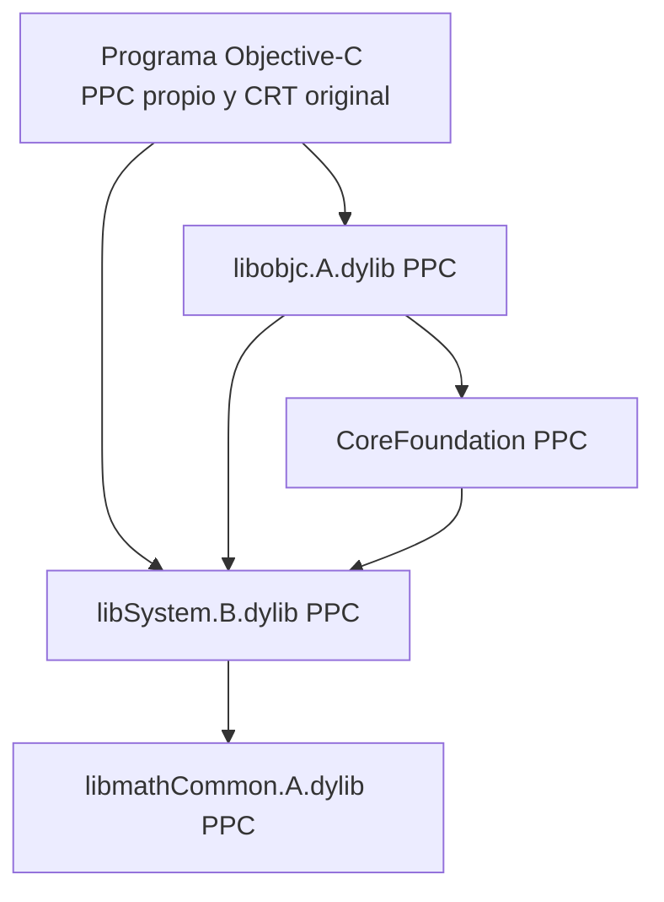

# CoreFoundation y Objective-C originales: estado 0.05

Las copias examinadas provienen del CD Darwin 6.0.2. Ambas contienen slices
PPC (CPU 18) e i386 (CPU 7). Este hito carga **PPC**, sin cambiar de arquitectura
a mitad de una llamada. La existencia de una slice i386 no demuestra todavía
que todos sus servicios funcionen en la instalación actual.



Dyld original carga y enlaza estas imágenes. Libobjc declara LC_LOAD_DYLIB
para CoreFoundation y libSystem; CoreFoundation declara libSystem. La dependencia
libmathCommon de libSystem ya se ejecutaba en 0.02–0.04. No se necesita agregar
Foundation o AppKit para preparar esta primera prueba.

| Componente | Versión observada | Fuente identificada |
| --- | --- | --- |
| libobjc.A.dylib | LC_ID_DYLIB current 218.0.0, compatibility 1.0.0; RPM objc4-222 | objc4-222, commit f44f3c371efbca9b0eeeffe3691888b6b53fb1f0; correspondencia candidata, no identidad binaria demostrada |
| CoreFoundation | current 262.0.0, compatibility 150.0.0; RPM CoreFoundation-262 | No fuente exacta identificada; la consulta de tags CF-262/263 del repositorio Apple no devolvió coincidencias; CF-299 existe y no se toma como equivalente |
| CRT | Csu-45 del laboratorio y crt del toolchain del CD | Startup original: inicialización Mach/hilo, constructores y _objcInit antes de main |

Los inventarios conservan dependencias, secciones, imports, exports y versiones:
[libobjc](inventory/usr_lib_libobjc.A.dylib.json) y
[CoreFoundation](inventory/System_Library_Frameworks_CoreFoundation.framework_Versions_A_CoreFoundation.json).
Los tags publicados se consultaron en el repositorio primario de Apple; no
encontrar CF-262 allí no demuestra que no exista en otro archivo histórico.
Se conserva la [respuesta de tags CF-2*](../reports/filesystem/cf-source-tags.txt).

## Contratos que aparecen antes de Foundation

En [objc4-222/runtime/objc-runtime.m](https://github.com/apple-oss-distributions/objc4/blob/objc4-222/runtime/objc-runtime.m),
`_objcInit` invoca `__CFInitialize`, prepara TLS, crea el hash de clases y registra
callbacks de imágenes dyld. Usa CFDictionary/CFSet para tablas del runtime.
No alcanza con cargar objc_msgSend y omitir esos pasos.

La implementación PPC de objc-msg-ppc.s usa layouts de clases, selectores,
cachés e IMP del ABI clásico. La primera prueba debe compilarse con ABI NeXT
de Jaguar, sin ARC ni metadatos ObjC2 modernos ni runtime GNU. Mientras caller
y runtime sigan siendo PPC, esos objetos permanecen big-endian en memoria;
la conversión de estructuras corresponde a los límites con el host.

Los imports muestran varias familias que deben distinguirse de lo ya probado:

| Familia | Situación |
| --- | --- |
| malloc, zonas, strings, stdio y operaciones BSD | Biblioteca original PPC; varias rutas ya probadas, no todas las funciones o flags |
| dyld callbacks y constructores, class/module metadata | Código original; las utilidades C no acreditaban todavía el registro de una clase propia |
| pthread TLS, mutex/cond y consulta de hilo | Inicialización de un hilo parcialmente ejercitada; no concurrencia general |
| Mach ports, host, VM | Personalidad emulada/puentes actuales; solo contratos documentados |
| reloj, timers, sockets, bootstrap, runloop, notificaciones | Imports posibles de CF; no se declaran compatibles por el solo hecho de cargar la imagen |
| ptrace | Bloqueo real del primer programa compilado: syscall 26, request 0xc000 |

## Primera prueba preparada y ejecutada hasta el bloqueo

[objc-smoke.m](../tests/ppc/objc-smoke.m) declara una clase propia derivada de
Object, instancia con `+new`, envía `-value` (debe devolver 42), libera el objeto
y debería imprimir `Objective-C PPC OK`. No usa Foundation, Cocoa ni GUI.

El GCC histórico dentro de Darwin **sí compiló**:

```sh
gcc2 -no-cpp-precomp -arch ppc -o build/objc-smoke tests/ppc/objc-smoke.m -lobjc
```

File e inventario confirman Mach-O PPC. La entrada original `0x1b1c` y el CRT
se ejecutan mediante dyld. En Linux y Darwin la ejecución termina en 125 al
alcanzar `ptrace(0xc000, 0, 0, 0)`, antes de completar main. No imprime el mensaje
de éxito. [Inventario propio](inventory/own_objc_smoke.json),
[log Darwin](../reports/filesystem/native-objc-real.stderr) y
[log Linux](../reports/filesystem/linux-objc-real.stderr).

Se preparó [darwin6-objc-probe.sh](../scripts/darwin6-objc-probe.sh) para repetir
compilación y ejecución con timeout y logs separados. Se descartó un caller
manual de ABI como prueba de aceptación: el programa compilado utiliza el
startup y los metadatos producidos por el toolchain original, sin adivinarlos.

## Próximo contrato por resolver

Primero caracterizar la petición ptrace observada contra el código/resultado
de Darwin original. XNU ya implementa syscall 26; el bloqueo está en la
personalidad del ejecutor. No justifica modificar el kernel ni devolver éxito
incondicional. Una respuesta compatible debe respetar errores, PID y request,
y no reenviar solicitudes de depuración del invitado a procesos del host.

Después exigir la secuencia completa de inicialización, registro de la clase
ReMaklarProbe y despacho del método con resultado 42. Solo entonces ampliar
a una prueba C de CFString/CFArray y, por separado, servicios de runloop.
Todavía no hay sustituciones nativas de CoreFoundation o libobjc: los originales
PPC permanecen como proveedores y sus servicios de sistema requieren contratos
explícitos. Cocoa, Finder, Aqua y XNU no forman parte de esta etapa.
