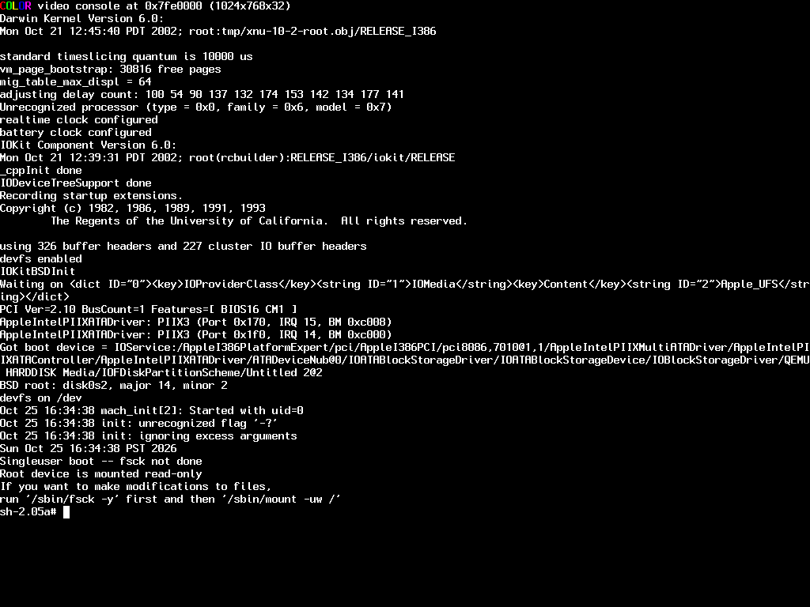

# ReMaklar 0.10 — First Aqua: avance y límite técnico verificado

Base del proyecto: `f10ee0c` (0.09). Plataforma conservada: Darwin 6 i386 y ejecutables PPC originales de Jaguar 10.2, build 6C115. **Todavía no se obtuvo Aqua, una ventana del instalador ni una superficie dibujada verificablemente por WindowServer.** Sí se consiguió arrancar la consola nativa en VESA y acceder desde PPC al framebuffer real de 32 bits. No se usó Quartz fuera de pantalla como sustituto de una interfaz.

El ejecutor final es `/var/tmp/graphics010-run19/qemu-ppc`, MD5 `53f668ee49ac74800d8837631755d1fe`. El avance de 0.10 se conserva en un commit local solicitado por el usuario. No se hizo push.

## Resultado de los programas originales

| Componente | Avance comprobado | Límite final |
|---|---|---|
| WindowServer | Supera 3825, registra `WindowServer` en el bootstrap real, abre IOHIDSystem/IONDRVFramebuffer, consulta IODisplay y sus propiedades, recorre padres e hijos, enumera modos, obtiene formato/stride, mapea VRAM y envía sus tablas originales de color al kernel. Crea correctamente el cursor compartido mediante el método escalar original. | RPC 2819, memoria tipo 100 del framebuffer: `StdFBShmem_t` necesita acceso compartido con adaptación de endianidad en vivo. Se rechaza explícitamente antes de exponer datos incorrectos. |
| Installer | Supera 3226, `vm_msync` y `mmap` de recursos originales. También se reintenta mediante splash en la ejecución conjunta. | Aborta con `INIT_Processeses(), could not establish the default connection to the WindowServer`. El proceso servidor muere antes de poder atender esa conexión. |
| splash | Abre servicios reales mediante IOKit y lanza el Installer original. Se ejecuta junto a los servicios, con `OS_INSTALL=1`. | No aparece la interfaz del instalador. Un retorno 0 del lanzador tras el aborto de su hijo no se considera éxito gráfico. |
| ATS | Supera `seteuid(1)` y la consulta de RAM física; el ATSServer original permanece vivo en recepción Mach hasta la limpieza del supervisor. | No se acredita todavía que atienda correctamente a todos sus clientes. |
| pbs | Supera `shm_open` y `ftruncate` usando objetos POSIX reales. | Intenta reservar 12 MiB en `0xff000000` y mapear en `0xff002000`; el modelo directo guest/host i386 no admite ese rango. Después accede a `0xff019f80` y termina por fault. |

Evidencia final conjunta: [WindowServer](../reports/graphics-010/final19/graphics010-joint19/windowserver.stderr), [splash/Installer](../reports/graphics-010/final19/graphics010-joint19/splash.stderr), [ATS](../reports/graphics-010/final19/graphics010-joint19/ats.stderr), [pbs](../reports/graphics-010/final19/graphics010-joint19/pbs.stderr) e [inventarios de procesos](../reports/graphics-010/final19/graphics010-joint19/processes.txt). Los hijos daemonizados se distinguen del líder; el registro de un puerto bootstrap no acredita que WindowServer esté operativo.

## Capacidades implementadas

El parche [0008-native-mach-graphics.patch](../patches/qemu-0.10.6/0008-native-mach-graphics.patch) modifica `darwin-kernel.c` y añade `mach-native.inc`.

- **Puertos y conjuntos reales:** allocate, type, refs/mod_refs, destroy/deallocate, insert/extract/move_member, atributos, get_set_status y notificaciones Mach ordinarias. XNU realiza la pertenencia múltiple y el arbitraje de las colas.
- **IPC y bootstrap:** `mach_msg` sobre capacidades nativas con conversión de cabeceras y descriptores de puertos; los bytes inline de aplicaciones PPC permanecen en su ABI. Registro, lookup y check_in llegan al bootstrap nativo original. Hay intercambio entre procesos PPC tras fork/exec, transferencia de send rights y respuesta usando send-once.
- **Memoria real:** 3825 `mach_make_memory_entry_64`, mapas de objetos mediante 3812/3826, offsets, protecciones, `vm_protect` y `vm_msync`. Se verifican alias con escrituras bidireccionales y supervivencia de mapas después de liberar el derecho del objeto. No se usan copias independientes como memoria compartida.
- **BSD/PPC32:** mmap/munmap con off_t en los registros correctos, offsets no alineados de Jaguar, mapas compartidos y COW; ftruncate; shm_open/shm_unlink reales, con namespace común a los procesos i386/PPC; seteuid/setegid/setgid/setuid nativos.
- **Reloj:** gettimeofday 116 ahora devuelve segundos/microsegundos en r3/r4, como `ppc_gettimeofday` de XNU 344. Libc PPC los almacena mediante su stub original. La conversión i386 anterior congelaba el reloj aparente de ciertos llamadores.
- **sysctl:** hw.physmem consulta al kernel real; devuelve 133.689.344 bytes tanto en i386 como PPC. hw.byteorder expresa la arquitectura del llamador: 1234/4321.
- **IOKit tipado:** servicio asociado, propiedades individuales/diccionarios XML, consulta de metaclase, iteradores de registro y padres, rutas, registro de notificaciones e interés, propiedades de conexión y sus códigos de resultado separados. Se conservan los puentes anteriores de open/close y escalares.
- **Framebuffer:** descripciones de píxel de 172 bytes; modo/timing de 204 bytes; lista de IDs de modos; tablas de conversión de color, distinguiendo bytes de UInt32. El puente 2819/2853 mapea/desmapea la VRAM nativa tipo 110, consulta sus permisos reales y mantiene los metadatos de páginas del traductor.

La referencia i386 demuestra que exec limpia los puertos ordinarios. Las tablas se limpian al hacer fork/exec donde corresponde, se conserva el bootstrap especial real y se evita reutilizar inmediatamente nombres virtuales obsoletos. No se perpetúan derechos nativos inválidos del ejecutor anterior.

El transporte no es una implementación universal de Mach: los descriptores OOL genéricos de aplicaciones siguen rechazándose; las respuestas OOL de las RPC tipadas tienen tratamiento propio. Las estructuras IOKit admitidas se restringen a los métodos y layouts verificados. El modo observado no ofrece timing detallado válido (`timing=0`); no se acredita esa ruta con relojes no nulos. El registro de notificaciones se comprueba contra el kernel; las pruebas no observaron un evento IOKit real y no acreditan su entrega completa.

## Vídeo auténtico, sin Aqua

El arranque previo `-s` ofrecía 640×400, 8 bits, `PPPPPPPP`, stride 0. La consulta i386/PPC coincidía, pero ese modo de texto no proporcionaba una VRAM gráfica utilizable: el kernel devolvía un error real de mapeo.

Se investigó exclusivamente la ruta del booter original. `boot-93`, commit `50de86c64087e10963dc5e4a93f35aa93612bf52`, coincide con la distribución 10.2 y con el booter presente, `Darwin/x86 boot v5.0.93`. Acepta:

```text
-s "Boot Graphics"=Yes "Graphics Mode"="1024x768x32"
```

Se aplicó a una **copia** del overlay y del FAT. El kernel informó `COLOR video console ... (1024x768x32)`. Después, ambos llamadores obtuvieron:

| Dato real | Resultado i386 y PPC |
|---|---|
| Resolución | 1024×768 |
| Píxel | 32 bits, `--------RRRRRRRRGGGGGGGGBBBBBBBB` |
| Bytes por fila | 4096 |
| VRAM mapeada | 16.777.216 bytes |
| Lectura y desmapeo | Correctos |

[Referencia i386](../reports/graphics-010/vesa17/graphics010-vesa17/framebuffer-native.stdout), [PPC](../reports/graphics-010/vesa17/graphics010-vesa17/framebuffer-ppc.stdout) y [prueba final PPC](../reports/graphics-010/final19/graphics010-regression19/framebuffer010-runtime.stdout).



La captura posterior continúa siendo una consola: [estado tras WindowServer](../reports/graphics-010/stage18-console.png). No se dibujó una interfaz propia para sustituir los programas originales.

## Obstáculo arquitectónico restante

Las dos referencias siguientes **abren, mapean, leen, desmapean y cierran objetos del kernel real**; son llamadores i386, no implementaciones PPC:

| Objeto compartido | Tamaño real | Valor nativo | Lectura PPC sin adaptar |
|---|---:|---|---|
| IOHIDSystem, tipo 0 | 20.392 bytes | EvOffsets.evGlobalsOffset = 8, bytes `08 00 00 00` | 134.217.728 |
| Framebuffer, tipo 100 | 278.764 bytes | StdFBShmem.version = 3, bytes `03 00 00 00` | 50.331.648 |

[IOHID nativo](../reports/graphics-010/vesa17/graphics010-vesa17/hid-native.stdout), [cursor nativo](../reports/graphics-010/final19/graphics010-regression19/cursor-native.stdout) y [rechazo verificable de WindowServer](../reports/graphics-010/final19/graphics010-joint19/windowserver.stderr).

`EvGlobals` contiene la cola de eventos, semáforos, campos de bits y estado que cambia desde el kernel. `StdFBShmem_t` combina locks, enteros, bytes, coordenadas de 16 bits, tiempos y datos del cursor. Ni una copia inicial con byte-swap ni invertir uniformemente palabras de 32 bits conserva ese contrato. Hay que adaptar los accesos TCG a esas regiones, incluidos accesos parciales, operaciones atómicas y layouts, manteniendo el mismo objeto físico compartido con el kernel. Exponer hoy el mapa sin esa adaptación haría que los originales leyeran offsets/versiones incorrectos y posiblemente corrompieran el estado compartido.

Por separado, pbs necesita traducir direcciones PPC altas hacia rangos host válidos: el ejecutor actual usa mapeo directo y el usuario i386 termina en `0xc0000000`. Devolver otra dirección a MAP_FIXED o afirmar que `0xff002000` está mapeado no sería correcto. Ambos obstáculos requieren ampliar el modelo de memoria del traductor, no otra respuesta MIG de éxito. No se introdujo ese atajo ni una refactorización masiva sin verificarla.

Fuentes Apple de época, cotejadas con los gitlinks de macOS 10.2: [IOGraphics-40](https://github.com/apple-oss-distributions/IOGraphics/tree/IOGraphics-40), commit `1fb82472d6897176bcc72b69c79d0c09440b1321`; [IOHIDFamily-33](https://github.com/apple-oss-distributions/IOHIDFamily/tree/IOHIDFamily-33), commit `f903d570cc6dc0d6ef978857e2e41d460e8c62f2`; [boot-93](https://github.com/apple-oss-distributions/boot/tree/boot-93). No se usan componentes de Tiger ni posteriores.

## Regresiones y referencias

Antes de ampliar código se ejecutó la suite sobre el ejecutor 0.09 run12, incluidos los cambios posteriores a run10. Pasaron las suites anteriores; los bloqueos iniciales se reprodujeron. Al finalizar se repitió la regresión sobre run19 en VESA:

| Prueba final | Resultado |
|---|---|
| Fixtures PPC en Linux | 11/11 |
| Mismos fixtures en Darwin i386 | 11/11 |
| Utilidades originales | 23/23 |
| Filesystem | 11/11, residuos 0 |
| Objective-C y CoreFoundation i386 | PASS |
| Señales, fork/execve/setsid/access, statfs/getfsstat/pathconf, IOKit previo | PASS |
| Mach/port sets/IPC/señal durante receive, mmap, shm y credenciales | PASS |
| Reloj, consultas/métodos del framebuffer, VRAM, cierre y referencia de cursor | PASS |

Los 19 estados del bloque final terminan 0, sin timeout ni descendientes restantes. Los stdout de las referencias i386/PPC coinciden para los llamadores comparables. El fallo de memoria negativo sale 126 nativo y 125 Linux, como en la suite previa. El fixture de instrucción ilegal imprime un diagnóstico adicional en stdout nativo: se reejecutó con 0.09 run12 y coincide exactamente, incluido exit 125; no se ocultó la diferencia.

Evidencia: [resumen verificable](../reports/graphics-010/regression-summary.json), [fixtures Linux](../reports/graphics-010/fixtures-final19.txt), [fixtures Darwin](../reports/graphics-010/native-fixtures19/results.txt), [utilidades](../reports/graphics-010/final19/graphics010-regression19/utilities.txt), [filesystem](../reports/graphics-010/final19/graphics010-regression19/filesystem.txt) y [sesión final](../reports/graphics-010/final19/graphics010-regression19/session.txt).

Se conservan también los fallos intermedios. Stage6 detectó el reloj PPC incorrecto y produjo una traza de 224.463.712 bytes antes de la interrupción manual y limpieza del hijo. El archivo completo permanece localmente; [SHA-256 y extractos](../reports/graphics-010/large-log-manifest.json) evitan incorporar ese volumen a Git. Stage9 compiló pero el arnés apuntaba por error a graphics009-r9; stage10 corrigió la ruta. No se clasifican esas tandas como PASS. Los supuestos erróneos de las primeras pruebas de exec, protección y mmap se corrigieron contra i386, conservando sus resultados.

## Preservación y reproducción

Los hashes finales de la ISO Jaguar y de `vm/darwin602.qcow2` coinciden con 0.09: [manifiesto](../reports/graphics-010/preserved-originals.json). No hubo instalaciones ni discos físicos de destino. Se conservaron overlays, compilaciones, payloads y exportaciones anteriores.

El FAT tuvo tablas temporalmente diferentes mientras el guest escribía; se copió con QEMU pausado a `build/exchange010-stage6-preserved.img` y se inspeccionó con fsck.fat -n, sin reparar el activo. Se preservó la primera exportación truncada y se recuperaron los logs. Las siguientes exportaciones enumeran resultados y no incorporan los árboles de compilación.

Después de sync y desmontar FAT, halt quedó atascado tras `proc_shutdown`. **No fue un apagado limpio.** Se guardó RAM y dispositivos mediante migración completa, se verificó `completed` y `paused (postmigrate)`, y luego se cerró QEMU. La captura completa está en `logs/graphics-010/halt-vmstate.bin`. Se copiaron los discos; solo la referencia al backing de la copia del overlay se actualizó para referenciar el backing absoluto correcto y se arrancó de nuevo. qemu-img check no encontró errores; fsck -p del guest sobre esa copia terminó sin errores mostrados. [Hashes y preservación de VM](../reports/graphics-010/vm-preservation.json), [check qcow2](../reports/graphics-010/graphics-overlay-check.txt), [comprobación UFS](../reports/graphics-010/vesa-filesystem-check.png).

El entorno final reutilizable usa `vm/darwin602-graphics-010-overlay.qcow2` y `build/graphics010-exchange.img`; el overlay anterior queda preservado. Los ejecutores run1–run19 permanecen en el guest. Los logs/payloads íntegros están bajo `logs/graphics-010/` y `build/graphics010-*`; la selección versionable está en `reports/graphics-010/`.

Para reconstruir el código desde el upstream, en WSL y usando un destino nuevo:

```sh
REMAKLAR_CHECKPOINT=0.10-graphics \
REMAKLAR_QEMU_DIR="$PWD/build/qemu010-reproduce" sh scripts/checkout-qemu.sh
python3 tools/package_graphics010.py --source build/qemu010-reproduce \
  --output build/graphics010-reproduce.tgz
```

Los ocho parches se aplicaron y comprobaron secuencialmente sobre QEMU v0.10.6, commit `9eab386edbf8cf002a731f8204a156f243a47a57`; los dos archivos finales coinciden byte a byte: [verificación](../reports/graphics-010/patch-reproduction.txt) y [manifiesto del parche](../patches/qemu-0.10.6/graphics-010-manifest.json).

Conservar el entorno 0.09 descrito arriba, extraer el paquete bajo `/var/tmp` y ejecutar `sh /var/tmp/graphics010-reproduce/run.sh`. Copia y reutiliza el árbol/build nativo 0.09, recompila incrementalmente, compila llamadores i386/PPC y realiza un ensayo conjunto acotado. El script exige un directorio nuevo de resultados; no borra los previos. No incluye binarios de Apple: utiliza el Jaguar original ya extraído. Los scripts stage1–stage19 son el historial de esta ejecución, no una secuencia que sea necesario repetir. La regresión completa y el ensayo VESA se conservan en los scripts `darwin6-graphics-010-regression.sh`, `-final.sh`, `-vesa.sh` y `-native-fixtures.sh`.

Para un nuevo arranque gráfico, el lanzador `scripts/darwin6-graphics-010-launch.py` exige las copias existentes y rechaza un monitor 4444 ocupado; después se introducen los argumentos documentados. La prueba no ejecuta rc.cdrom completo ni una instalación.

## Estado de cierre

La VM queda encendida en single-user y VESA, con sync completado y FAT desmontado. El [inventario final](../reports/graphics-010/graphics010-final-processes.txt) solo muestra init, mach_init y la shell, además del propio ps; no quedan procesos traducidos pendientes. [Captura final de consola](../reports/graphics-010/final-console.png).

Queda infraestructura Mach/IPC/memoria real comprobada, un framebuffer de 32 bits accesible por PPC y los tres programas originales más avanzados. **No hay GUI funcional.** La siguiente implementación necesaria es el acceso compartido con adaptación viva de ABI para StdFBShmem/IOHID, junto al direccionamiento alto requerido por pbs. Se dejó el rechazo explícito y la evidencia nativa necesaria para abordarlo sin datos ficticios.
